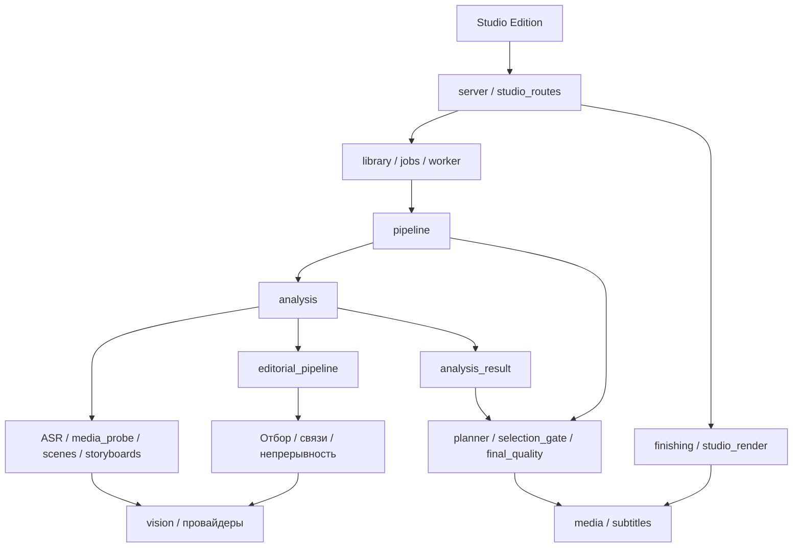

# Зоны ответственности КАДР

Это указатель к рабочему коду. Полная [карта модулей и файлов состояния](../docs/audit/storage-and-modules.md) описывает каждый модуль и его результаты. Единственный интерфейс — Studio Edition в `frontend/public`; API и реальные сохранённые данные являются источником состояния.

| Зона | Основные владельцы | За что отвечает | Граница |
|---|---|---|---|
| HTTP и интерфейс | `server`, `studio_routes`, `http_media` | Проверка HTTP-входа, API, пять ресурсов Studio, выдача медиадиапазонов | Не принимает сюжетные решения; `http_media` получает уже разрешённый путь и не создаёт приложение |
| MCP продукта | `mcp_server`, `mcp_runtime`, `mcp_contract`, `mcp_product` | stdio, схемы, защищённый повтор команд и адаптация существующего loopback API | Не создаёт JobManager/Studio, не импортирует devtools и не запускает agy; изменения выполняют прежние HTTP-владельцы |
| Проекты и задания | `library`, `jobs`, `worker`, `launcher` | Каталог серий, один фоновый worker, запуск/остановка, сохранение состояния задания | Не реализует модели или математику интервалов; домены не импортируют jobs ради JSON |
| Общая инфраструктура | `json_store`, `source_ranges`, `source_text`, `content_identity`, `source_identity`, `cancellation`, `file_lock` | Атомарный JSON, интервалы, цитаты/токены, hashes, отмена, блокировка ОС | Не импортирует конвейер, сервер или предметные зоны; одна реализация общей операции |
| Выбор модели | `analysis_provider`, `vision`, `deepseek`, `hybrid`, `antigravity_exchange`, `antigravity_batch`, `flash_story_trial` | Настройки/маршрутизация, сеансы и транспорт запросов, пакеты ручного CLI | Ответ модели проходит предметную проверку; agy запускается отдельным пользовательским сценарием |
| Исходные факты | `media_probe`, `inference`, `provided_asr`, `media_evidence`, `scene_detection`, `semantic_boundary`, `bounded_storyboard`, `scene_preparation` | Реальные дорожки, речь, склейки, кадры и смысловые границы | Не придумывает исходные таймкоды и не вызывает координатор analysis обратно |
| Понимание и отбор | `scene_analysis`, `scene_understanding`, `story_review`, `story`, `scene_refinement`, `closing`, `titles`, `production`, `production_sequence`, `source_roles`, `eyecatch`, `global_verification`, `pacing`, `endings`, `framing` | Предметные решения по кадрам/репликам, выбранные единицы и доказательства | Не пишет общий job-status и не организует экспорт |
| Структура и полнота истории | `story_structure_pass`, `dialogue_relations`, `story_structure`, `source_continuity`, `continuity_verification`, `speech_context`, `speech_handles`, `episode_profile` | Связи, факты, арки, контекст и подтверждённая непрерывность | Проверки не превращают отсутствие данных в подтверждение |
| Координаторы | `pipeline`, `analysis`, `editorial_pipeline`, `analysis_result`, `quality_recovery` | pipeline: этапы/возобновление/экспорт; analysis: получение фактов; editorial_pipeline: итоговый отбор; analysis_result: сборка результата; quality_recovery: ограниченное восстановление | Делегируют вычисления владельцам; результат собирается без нового inference |
| План и контроль качества | `planner`, `dramatic_planner`, `viewer_interest`, `retention_allocation`, `planner_audit`, `selection_gate`, `selection_adjudication`, `final_quality`, `quality`, `editorial` | Детерминированный план, отдельные оценки сюжетной ценности и зрительского интереса по source evidence, допуск к экспорту, диагностика, редакторская политика | final_quality проверяет; quality_recovery исправляет. Второй альтернативный simulation planner удалён |
| Отдельные истории | `story_objective`, `standalone_analysis`, `discovery_regions`, `episode_survey`, `candidate_analysis`, `candidate_screen`, `story_candidates`, `analysis_questions`, `standalone_planner`, `standalone_pipeline`, `candidate_framing`, `artifact_publication`, `checkpoint_lineage` | Обзор всей серии отдельно от предложений монтажа; независимая проверка исходных событий и отдельная оценка только сохранённого монтажа; планы, кадрирование и неизменяемая публикация | Гипотезы и черновики не разрешают экспорт. Число роликов не меняет исходный обзор. Старые selective-контракты сохраняют прежние selective_analysis/unit_decisions и валидаторы |
| Оформление и вывод | `finishing`, `finishing_commands`, `finishing_execution`, `finishing_worker`, `finishing_render`, `finishing_profile`, `finishing_avatar`, `social_frame`, `studio_render`, `clean_parts`, `media`, `subtitles`, `editing`, `music`, `audio_analysis`, `part_context` | Настройки оформления, иконки, чистые части, предпросмотр, MP4/SRT; studio_render фиксирует входы, повторно использует неизменённые части и выбирает проверенные готовые файлы | finishing использует готовый базовый план; обычный GET не запускает inference; профиль и карточка не владеют HTTP или анализом |
| Наблюдаемость и подписи | `job_progress`, `pipeline_diagnostics`, `model_perf`, `token_usage`, `run_logging`, `semantic_identity`, `studio_identity`, `config` | Прогресс, журналы, измерения, фактические версии/настройки | Подписи учитывают изменённые зависимости, неизвестные показатели не заменяются вымышленными |

`finishing_commands` хранит неизменяемые команды и квитанции частей; `finishing_execution` управляет очередью и процессами, `finishing_render` исполняет сохранённые входы. API и интерфейс продолжают и отменяют существующие команды ([ADR-0056](../docs/ai/decisions/0056-durable-finishing-commands.md)).

`render_ancestry` находит точное совпадение рендера в явной цепочке `checkpoint_lineage`; `artifact_publication` хранит неизменяемую ссылку на исходную ревизию. `clean_parts` проверяет SHA256 и квитанцию полного декодирования. Incremental не копирует clean/output/render между заданиями ([ADR-0057](../docs/ai/decisions/0057-explicit-render-artifact-ancestry.md)).

`audio_boundaries` измеряет исходный PCM около предложенных склеек. Компилятор выбирает технические границы до исходной и зрительской проверок; изменение допущенного монтажа во время рендера запрещено. Измерения звука не подтверждают завершённость действия ([ADR-0058](../docs/ai/decisions/0058-measured-audio-edit-boundaries.md)).

`review_feedback` связывает замечания в просмотре с новым заданием исправления. HTTP только сохраняет запрос и читает историю; worker/pipeline владеют моделями и экспортом. Исходные границы OP проверяет production_sequence, границы речи — speech_handles вместе с независимым final_quality. Предыдущие план и видео остаются в своей версии; подробности в [ADR-0040](../docs/ai/decisions/0040-montage-review-feedback.md).

Поток вызовов:

Общие операции импортируются непосредственно из своих модулей. Нельзя импортировать `server` из предметного модуля или `analysis` для получения utility-функции: это закреплено регрессионной проверкой. `pipeline` может вызвать `analysis.analyze` как следующий этап. Разные правила предметной валидации остаются в своих зонах, даже если внешне похожи.

У `json_store` одна атомарная реализация записи: уникальный временный файл, flush/fsync, ограниченный повтор при Windows-lock и очистка при сбое. `atomic_json` сохраняет строгий JSON состояния; `analysis_json` и `compact_json` задают прежние форматы, не содержат копий алгоритма. Существующие проверки анализа отвечают за допустимость его чисел. Чтение повреждённого JSON не маскируется значением по умолчанию.

Сохранённые задания, источники и ответы моделей не удаляются при рефакторинге. Совместимость checkpoint проверяется по настоящему коду и входам; изменение логики может сделать отдельный checkpoint несовместимым. Тестовые fixtures хранятся только в изолированных проверках и не попадают в Studio.

Все существующие проверки отправляют целевые source units и необходимые доказательства. `review_scope` задаёт допустимые участки, предметные модули выбирают контекст по исходному времени, `request_payload` уплотняет отправляемый текст для всех провайдеров. Экономия отключает дополнительные виды проверок; полный режим также не разрешает повторную проверку лишь из-за тишины, важности или позиции сцены. Правила по каждой группе и ограничения точечного восстановления описаны в [ADR-0050](../docs/ai/decisions/0050-needed-data-for-all-model-checks.md).

Точечные исправления существующих проверок делегируются `scoped_boundary_recovery`, `scoped_owner_refresh`, `scoped_relations` и `scoped_ending_recovery`. `scoped_recovery_state` хранит проверяемое соответствие derived events исправленным сценам отдельно от raw perception. `editorial_reactions` разделяет предпочтения реакции/юмора; native source validators остаются у прежних владельцев. См. [ADR-0051](../docs/ai/decisions/0051-scoped-repair-and-exact-request-reuse.md).

`asr_audio` владеет подготовкой и проверенным повторным чтением ASR PCM из своего задания или явно связанного предка. `analysis` запрашивает этот путь только для распознавания/исправления ASR; `inference` читает его без изменения. `processing` не копирует root WAV и временный perception WAV при наследовании. Правила источника, receipt и совместимости: [ADR-0065](../docs/ai/decisions/0065-source-owned-asr-pcm-reuse.md).
