# Аудит КАДР — карта приложения и реальные локальные замеры

Дата: 11–12 октября 2026. Аудит относится к рабочему состоянию `F:/new_prodject`, включая очистку, исправления этого аудита и временный ручной режим Antigravity. Исходники, пользовательские проекты, история, модели и результаты сохранены.

## Как читать

1. [Общая схема и вложенные блоки](architecture.md): вход → интерфейс/API → worker → распознавание → модели → отбор → план → экспорт → проверка. Затем детализация каждого этапа, отмены и повторного запуска.
2. [Файлы, данные и модули](storage-and-modules.md): что хранится где, что входит в backup, назначение собственного кода и тестов, какие интерфейсы активны.
3. [Запуск, остановка, BAT, интерфейс и журналы](operations.md): ежедневная работа, диагностические файлы, исправленные ошибки и проверки.
4. [Результаты реальных замеров](performance-results.md): 120 и 180 секунд, таблицы, графики, запросы/токены, память, GPU/CPU и фактический исход каждого прогона.
5. [Как устроены измерения](performance-design.md): границы таймеров, вложенность, кэш, ограничения и способы повторить опыт.
6. [Проблемы и порядок улучшений](findings.md): исправленные дефекты, оставшиеся риски и гипотезы оптимизации.
7. [Структура собственного кода и границы очистки](code-quality.md): граф импортов, крупные модули, совместимость и подтверждённо неиспользуемые импорты.
8. [Antigravity CLI с отдельным запуском](../antigravity-manual.md): временный режим, пакеты, ручной или автоматический приём файлов, возобновление, возврат к Qwen и реальные короткие проверки.

## Основная структура

```mermaid
flowchart LR
    Source[MP4 / MKV] --> UI[Studio Edition]
    UI --> API[FastAPI / каталог / задания]
    API --> Worker[Изолированный worker]
    Worker --> ASR[FFmpeg + Whisper]
    ASR --> Vision[Qwen 4B: события и кадры]
    Vision --> Story[Qwen 9B: отбор и связность]
    Story --> Plan[План / проверки качества]
    Plan --> Render[FFmpeg: MP4 + ASS / SRT]
    Render --> Review[Просмотр / таймлайн / оформление]
    Worker --> State[Артефакты / кэш / диагностика]
    Review --> State
```

Эта схема показывает полностью локальный маршрут. DeepSeek — отдельный выбранный провайдер анализа. В измерительных запусках его HTTP-вызовы запрещены; никаких платных запросов для аудита не выполняется. Обычные настройки пользовательских серий не переключаются.

Оба свежих локальных прогона120/180с завершились таймаутом около часа без готового монтажа. Пользовательский целевой предел для180с —30мин; скорость этому пределу не соответствует. Основная измеренная проблема — последовательные9B запросы и разрастание технических подзадач. Последующая проверка Antigravity отдельно выполнила один настоящий облачный пакет; она не входит в полностью локальные замеры.

## Ежедневная работа

- Запуск: `1_Запустить_Кадр.bat`.
- Сохранить настройки серии, выбрать нужный провайдер и запустить монтаж. Сохранение настроек само обработку не запускает.
- Отмена обработки: кнопка в интерфейсе. Продолжение использует сохранённые этапы с проверкой их совместимости.
- Остановка приложения: `остановить_Кадр.bat` после окончания/отмены обработки и окончания экспорта оформления.
- Последняя диагностическая сессия: `logs/LATEST.txt`; подробности и различия журналов — в операционном аудите.
- Для backup сохранять как минимум исходники, `data/` и корневую `finishing/`; модели/инструменты можно восстановить, успешный платный кэш полезно сохранить.

## Границы достоверности

Схемы и реестр сверены с кодом. Технические тесты не доказывают художественную удачность монтажа. Короткие прогоны не проверяют всю серию, а использованные фрагменты — одна сцена одного исходника. Результат, ошибка, остановка или тайм-аут каждого опыта отражаются отдельно; пропущенный этап не получает выдуманное время.

План выполнения и текущие проверки: [ExecPlan](../../.agent/plans/full-project-audit-2026-10-11.md). Сырые локальные свидетельства находятся под `temp/local-audit-20261011/`, публичные таблицы/графики не содержат расшифровок, кадров, ключей и модельных промптов.
