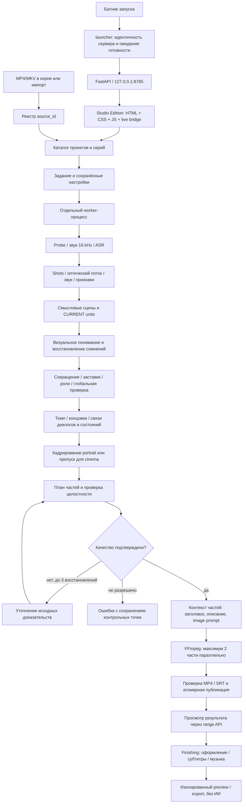
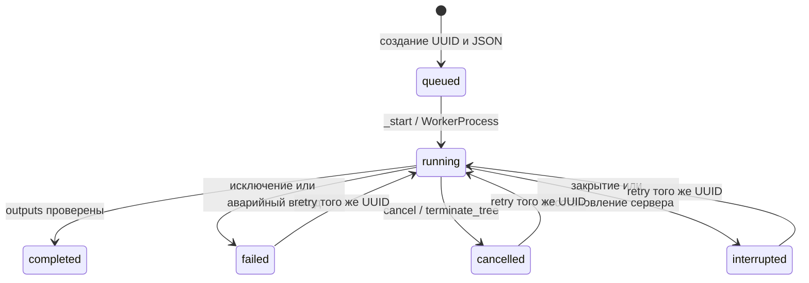
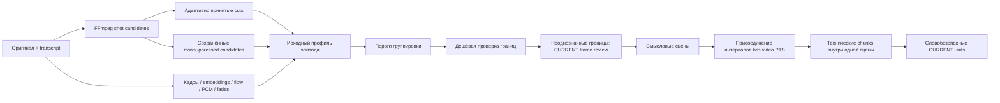
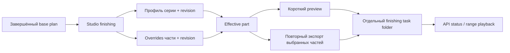

# КАДР: многоуровневая схема приложения

Дата аудита: 11 октября 2026 года. Основа — фактически прочитанный код в рабочей папке, а не прежние описания или результаты старых тестов. Это карта исполнения и места для диагностики; успешность реального прогона и длительности нужно смотреть в отдельном отчёте измерений. Частные настройки и ключи не читались. Каталог модулей и файлов результата — в [карте хранения](storage-and-modules.md).

Термины в схеме:

| Термин | Простое значение |
|---|---|
| Source / источник | Исходный видеофайл, который монтаж не изменяет |
| Job / задание | Одна попытка обработки с собственным номером, настройками, историей и результатами |
| Shot / план камеры | Непрерывный кусок изображения между монтажными склейками оригинала |
| Scene / смысловая сцена | Связанный эпизод действия; может состоять из множества смен камеры |
| Chunk / техническая часть сцены | Ограниченный фрагмент, который модель получает за один запрос; не самостоятельная новая сцена |
| Unit / исходная единица | Маленький заранее ограниченный отрезок оригинала, который разрешено выбрать или исключить |
| Event / событие | Запись понимания сцены: описание, её исходные единицы, выбранные интервалы и доказательства |
| Proof / evidence | Кадр, точная реплика или проверенная связь, на которую опирается решение; уверенность модели сама по себе не подтверждает правду |
| Checkpoint / контрольная точка | Сохранённый законченный этап, пригодный для продолжения после проверки совместимости |
| Signature / fingerprint | Подпись входных данных, настроек и версии логики, чтобы не использовать чужой или устаревший результат |
| Gate / проверка готовности | Условие допуска к следующему этапу; неразрешённая ошибка останавливает выпуск |
| Part / выходная часть | Финальный вертикальный ролик из последовательности выбранных исходных интервалов |

## 1. Общая схема

КАДР принимает исходное MP4/MKV, распознаёт русские реплики, извлекает визуальные и звуковые признаки, строит смысловые сцены и проверяет доказательства отбора. После сокращения он формирует хронологические части с исходным звуком, субтитрами и вертикальным изображением. Пользователь просматривает результат и при необходимости меняет оформление, текст субтитров и музыку в отдельном повторном экспорте.

Основные координаторы: [server.create_app](../../app/server.py), [JobManager](../../app/jobs.py), [worker.main](../../app/worker.py), [pipeline.run_job / _run_job](../../app/pipeline.py), [analysis.analyze](../../app/analysis.py). Модельный JSON не является монтажным планом: валидаторы сопоставляют ответ с заранее определёнными source/event/unit IDs и диапазонами оригинала; рендер принимает проверенный план.

## 2. Вход, запуск, интерфейс и каталог

### 2.1. Запуск

`1_Запустить_Кадр.bat → start.bat → tools/python/python.exe -m app.launcher`. [start.bat](../../start.bat) задаёт проектные TEMP/TMP/TMPDIR и кэши Python/npm, проверяет portable Python и наличие четырёх Studio assets, сравнивает `frontend/public` с `frontend/dist` через `fc /b`, при необходимости вызывает существующий `npm run build` через проектный [npm wrapper](../../scripts/npm.cmd). [launcher](../../app/launcher.py) проверяет доступность порта, идентичность запущенного экземпляра и открывает страницу после готовности. [studio_identity](../../app/studio_identity.py) сообщает подписи backend/UI; API запускается на loopback, порт 8765. [ПОСМОТРЕТЬ_ИНТЕРФЕЙС.bat](../../ПОСМОТРЕТЬ_ИНТЕРФЕЙС.bat) вызывает тот же запуск, [открыть_логи.bat](../../открыть_логи.bat) открывает `logs`.

Добавленный [остановить_Кадр.bat](../../остановить_Кадр.bat) вызывает `app.launcher --stop`: проверяет identity и отправляет `POST /api/studio/shutdown`. Сервер принимает остановку только без анализа и finishing-задач, ставит shutdown flag под mutex и запрещает новые изменяющие запросы до завершения. Это остановка проверенного приложения, без убийства случайного процесса по номеру порта. Для принудительного прерывания обработки остаётся Ctrl+C в его консоли с сохранением interrupted state.

Установка выполняется отдельно через [setup.bat](../../setup.bat) и [scripts/setup.py](../../scripts/setup.py). Рабочий анализ использует локальные инструменты и offline model paths; `setup_environment` выставляет `HF_HUB_OFFLINE` и `TRANSFORMERS_OFFLINE`.

### 2.2. Какая реализация UI реально активна

| Реализация | Доступ и назначение | Где изменять |
|---|---|---|
| Studio Edition | Каноническое приложение `/`, `/projects`, переходы `/project/...`, `/episode/...`, `/studio`, `/trash`, `/api` | [HTML](../../frontend/public/studio-edition.html), [CSS](../../frontend/public/studio-edition.css), [app JS](../../frontend/public/studio-edition-app.js), [live bridge](../../frontend/public/studio-live-bridge.js) |
| React | Отладочный вход `/react-debug`; отдельные страницы и компонентные тесты | [App.tsx](../../frontend/src/App.tsx), `frontend/src/pages`, `frontend/src/components` |
| Legacy | Справочный интерфейс `/legacy`, статика `/static` | [app/static](../../app/static/index.html) |
| Reference HTML | Отдельный макет `/studio-edition-reference.html` | [reference](../../frontend/public/studio-edition-reference.html) |

Vite копирует public assets в dist. Python не выполняет JSX: [catch-all в server](../../app/server.py) выдаёт собранный Studio HTML и перенаправляет глубокие ссылки на `studio-edition.html?screen=...&project=...&episode=...&job=...`. Неизвестные экраны дают 404. Изменение React-компонента само по себе не меняет активный Studio экран.

[live bridge](../../frontend/public/studio-live-bridge.js) загружает `/api/library`, `/api/sources`, `/api/jobs`, `/api/music`, `/api/health`, затем безопасные публичные сведения DeepSeek. Полные планы и caption overrides подгружаются для выбранного завершённого задания, а не для всей истории; captions запрашиваются пакетами максимум по четыре. Он нормализует `plan.source.duration` в UI `plan.duration`, связывает старые задания с эпизодами и обновляет frontend state после API-мутирования. [Studio app](../../frontend/public/studio-edition-app.js) содержит экраны, обработчики действий и периодический опрос статуса с защитой от наложения опросов.

### 2.3. Источник и владение

1. [JobManager.list_sources](../../app/jobs.py) видит MP4/MKV непосредственно в корне и `data/imports/*/*`, не весь диск. Назначает UUID источника и записывает `data/sources.json`.
2. `POST /api/import` проверяет имя и лимит 20 ГБ, записывает `data/imports/<UUID>/.upload`, проверяет медиа FFprobe и переименовывает в окончательный файл. Частичная загрузка удаляется при выходе.
3. [Library](../../app/library.py) хранит проекты, серии, источник серии, настройки и ссылки на задания в `data/library.json`. Один активный эпизод владеет одним источником. Каталог работает под mutex менеджера.
4. `PUT /api/episodes/{id}/settings` сохраняет выбор, `POST /api/episodes/{id}/jobs` запускает сохранённый профиль. Исторический `POST /api/jobs` принимает source_id/provider/layout/caption_style напрямую.
5. Архивирование проекта или серии — tombstone каталога, не удаление медиа. Удаление job и prune job — физическое удаление каталога задания. Возобновляемые незавершённые задания bulk prune защищает.

Настройки разделены: analysis provider, rendering layout/captions и editorial profile. Музыка загружается отдельно и не является настройкой конкретного inference-запроса. Системные пути определяет [config.py](../../app/config.py).

### 2.4. HTTP граница

[server](../../app/server.py) ограничивает Host loopback-адресами; изменяющие запросы проверяют Origin, `Sec-Fetch-Site` и Content-Type. Источник и результаты отдаются только по зарегистрированным IDs/именам, с HTTP Range/HEAD; произвольное имя файла из браузера не становится файловым путём. OpenAPI/Swagger выключены. CSP запрещает внешние scripts/media. Экспорт `save-videos` копирует только зарегистрированные MP4 в выбранную пользователем папку; этот пользовательский экспорт может быть вне workspace. Во время данного аудита такой экспорт не выполнялся.

## 3. Задание, процесс, отмена и продолжение

[JobManager.create](../../app/jobs.py) пишет `source.json`, `analysis-settings.json`, `render-settings.json`, `job.json` до запуска worker. Одновременно разрешён один анализ серии; finishing tasks также блокируют новый анализ. Список jobs восстанавливается по `data/jobs/*/job.json`, отдельной SQL базы нет.

[WorkerProcess](../../app/jobs.py) запускает отдельный Python child и на Windows помещает его потомков в Job Object. [worker](../../app/worker.py) ждёт `.start` до 30 секунд, чтобы модельные дочерние процессы не появились до установления владельца. Сообщение progress записывается в job JSON и operational logs. `.cancel` опрашивается в этапах и subprocess loops; менеджер отмены дополнительно принудительно завершает только дерево этого worker. `.cancel` удаляется при retry.

`retry` разрешён для failed/interrupted/cancelled и сохраняет UUID и checkpoints. При старте сервера queued/running на диске становятся interrupted. Watcher не может очистить `active` нового retry: он проверяет идентичность старого child. Ошибка записи статуса отмены временно сохраняется в `pending_states` и повторно публикуется при чтении.

Важно: принудительное завершение дерева может обойти Python `finally`. Поэтому последнее `timings.json` может отсутствовать, а `request_start` оставаться без `request_end`. Это незавершённое измерение, а не нулевая длительность. Восстановление выполняется по артефактам и проверенным подписям.

## 4. Анализ: блоки и модели

### 4.1. Распознавание речи

| Подэтап | Код | Вход → результат |
|---|---|---|
| SHA-256 оригинала и версия | `analysis.analyze` | source → `analysis.meta.json` |
| Probe | [media_probe.probe_media](../../app/media_probe.py) | контейнер/потоки → duration, fps, width/height, audio stream |
| Звук | `analysis.analyze` + FFmpeg | выбранный audio stream → PCM16 mono 16 kHz `audio.wav` |
| ASR child | [inference.transcribe](../../app/inference.py) | audio → words/segments с временными метками |
| Локальная починка ASR | `repair_transcript` / `--repair-only` | подозрительные VAD-паузы → bounded re-recognition, repair provenance |
| Нормализация | `media_probe.normalize_transcript` | метки в границах source → `transcript.json` |

Whisper large-v3 хранится в `models/whisper-large-v3`, backend faster-whisper/CTranslate2: CUDA `int8_float16`, fallback CPU `int8` с 8 потоками; язык ru, `word_timestamps=True`, VAD, beam_size=5. Процесс ASR завершает работу до запуска VLM и освобождает GPU память. Для `provided` transcript проверяется source SHA и строгие временные границы через [provided_asr](../../app/provided_asr.py); такая ветка не считается выполненным распознаванием.

### 4.2. Смена планов, признаки и смысловые сцены

[media_probe.shot_checkpoint](../../app/media_probe.py) сохраняет принятые и подавленные кандидаты. [media_evidence.perception_checkpoint](../../app/media_evidence.py) измеряет изображение, внутриплановое движение, звук и паузы; наличие cuts или flow не доказывает сюжетное действие. [episode_profile.build_episode_profile](../../app/episode_profile.py) получает фактический профиль и пороги `scene_settings`.

[scene_detection.scene_checkpoint](../../app/scene_detection.py) объединяет camera changes одного места/состояния в смысловую сцену; [semantic_boundary.verify_boundary](../../app/semantic_boundary.py) применяет VLM к спорным границам с before/current/after исходными кадрами. Контекст не получает права удалить соседнюю сцену. [scene_analysis.frame_backed_scenes](../../app/scene_analysis.py) объединяет интервалы без реально декодированного video PTS с соседями, сохраняя исходное покрытие. `analysis_chunks` — техническая экономия контекста внутри сцены, не самостоятельные сюжетные сцены.

### 4.3. Визуальное понимание и восстановление

[scene_analysis.analyze_scenes](../../app/scene_analysis.py) создаёт source units и storyboard каждой сцены/части, хранит индивидуальные checkpoints. [vision.inference_storyboard](../../app/vision.py) и [bounded_storyboard.build_bounded_storyboard](../../app/bounded_storyboard.py) привязывают картинки к действительным исходным временным меткам. Для first/last технического chunk добавляется ближайший соседний визуальный контекст; внутренний chunk получает CURRENT images и текстовый контекст.

Схема ответа ограничивает известные units, selected ranges, confidence, visual/semantic/context уверенность, видимые состояния и action evidence. [scene_understanding.recovery_trigger / recover_chunk](../../app/scene_understanding.py) при сомнениях запускает плотные исходные кадры. Неустранённые сомнения сериализуются, а не молча объявляются качественным анализом.

### 4.4. Сокращение и подтверждение отбора

Порядок в [analysis.analyze](../../app/analysis.py) существенен:

1. [scene_refinement.refine_scene_story](../../app/scene_refinement.py) вызывает [story.refine_story](../../app/story.py) для bounded технических детей, затем восстанавливает одного владельца сцены и ограничивает proof ranges границами исходника.
2. `preserve_dialogue_in_credits` и `clean_credit_continuations` защищают реальные диалоги и уточняют OP/ED. [production.clean_sequences](../../app/production.py) направляет page-capable провайдеры в [production_sequence.clean_whole_sequences](../../app/production_sequence.py), иначе использует исходные units и контекстные contact sheets.
3. [eyecatch](../../app/eyecatch.py) обрабатывает середину серии; [titles.refine_titles](../../app/titles.py) независимо подтверждает production-title cards; [closing.refine_closing_novelty](../../app/closing.py) сравнивает поздние фрагменты с ранее сохранёнными фактами.
4. [source_roles.refine_source_roles](../../app/source_roles.py) различает оригинальные роли текста/речи/заставки и подтверждает исключения исходными доказательствами.
5. [global_verification.verify_global_visual](../../app/global_verification.py) независимо смотрит оригинальные картинки и корректирует units. [selection_gate.adjudicate_selections](../../app/selection_gate.py) вызывает [selection_adjudication.adjudicate_event](../../app/selection_adjudication.py) для disputed/unknown coverage.
6. [story_review.global_story_review](../../app/story_review.py) формирует текстовую глобальную историю, keep/omit/dependencies по существующим event IDs. [speech_context.protect_speech_context](../../app/speech_context.py) восстанавливает смысловые префиксы и вопрос/ответ, используя фактический ASR.
7. Сохранение `story-events.json` с signature и complete/degraded state отделяет дорогой story pass от последующего оформления.

Подтверждённый OP имеет проверенные границы и production anchors. Для чистого ED нужен `wholly_nonstory=true` без narrative exceptions. Случайный кадр знакомого персонажа или безречевой эпизод сам по себе не является доказательством заставки. Обнаруженное исключение из этого принципа в эвристике eyecatch указано ниже.

### 4.5. Темп, концовки, структура и связи

[pacing.refine_pacing / refine_silent_sequences](../../app/pacing.py) рассматривают selected silent units и длинные безречевые последовательности, с current/neighbor frames и retained witness для повторения. Смысловые реакции, действия и speech handles сохраняются при положительном evidence.

[analysis.finalize_editorial_selection](../../app/analysis.py) сначала проводит source-only adjudication, проверяет selection readiness, затем [endings.refine_endings](../../app/endings.py); если концовки изменили отбор, adjudication повторяется. При успешном gate [story_structure_pass.infer_story_structure](../../app/story_structure_pass.py) извлекает канонические факты, состояния и source-unit relations, [dialogue_relations.infer_dialogue_relations](../../app/dialogue_relations.py) фиксирует обмены без зависимости только от ASR-пунктуации. Эти text passes наследуют уже принятое визуальное доказательство; они не являются независимым просмотром видео.

### 4.6. Кадрирование

[framing.refine_focus](../../app/framing.py) работает для `portrait`: кадры внутри реально выбранных диапазонов, реплики/смена плана и temporal samples определяют x/y субъекта. Координаты проверяются и ограничиваются; hard cuts не сглаживаются как движение одного кадра. [media.crop_expressions](../../app/media.py) сглаживает перемещение внутри shot.

`cinema` сохраняет полный резкий кадр на размытой вертикальной подложке и пропускает запросы focus. Это серьёзная разница вычислительной стоимости; сравнивать два прогона нужно с одинаковым layout.

### 4.7. Модели и провайдеры

| Режим | Раннее понимание / границы | Story и проверка | Pacing | Portrait focus |
|---|---|---|---|---|
| `local` | Qwen3.5 4B | Qwen3.5 9B с thinking | 9B без thinking | 9B без thinking |
| `deepseek_plan` | DeepSeek adapter | DeepSeek adapter | DeepSeek adapter | Локальный 9B |
| `deepseek` | DeepSeek adapter | DeepSeek adapter | DeepSeek adapter | DeepSeek adapter |
| `hybrid` | Локально, remote review при сомнениях | Локально + remote review | Локально + review | Локально + review |
| `local_fast_story` | 4B | 4B экспериментально | Локальный 9B | Локальный 9B |
| `local_flash_story`, `local_flash_story_budgeted` | Локальный 4B | TrialStoryVision / DeepSeek | TrialStoryVision | TrialStoryVision |

Последние режимы — совместимость/экспериментальные маршруты, а не альтернативное название fully local. Источник истины: [vision.vision_session](../../app/vision.py) и [analysis.framing_provider](../../app/analysis.py). В `deepseek_plan` ранняя semantic boundary session тоже уходит в remote; название «план» не означает, что изображения остаются только на компьютере.

Local paths: `models/qwen/Qwen3.5-4B-UD-Q4_K_XL.gguf`, `models/qwen9/Qwen3.5-9B-UD-Q4_K_XL.gguf`; у каждой модели свой `mmproj-F16.gguf`. [LocalVision](../../app/vision.py) запускает llama-server с Vulkan GPU layers, context=8192, parallel slots=1, offline, prompt cache выключен, image tokens 256–2048. Story thinking budget 512; некоторые простые classifiers могут отключать thinking только для запроса. Startup deadline 180 секунд; HTTP completion timeout 240 секунд. При GPU start failure или HTTP 5xx возможен CPU fallback; это видно в model telemetry.

Модельные сессии последовательные: boundary 4B → scene 4B → story 9B → pacing 9B → optional focus 9B → optional quality recovery / part context. Каждая сессия запускает/закрывает отдельный llama-server. Это освобождает память для 8 ГБ VRAM, но повторяет startup cost.

## 5. План, финальная проверка, контекст и экспорт

[pipeline._run_job](../../app/pipeline.py) валидирует анализ и строит детерминированный [planner.build_plan](../../app/planner.py) либо [dramatic_planner.build_dramatic_plan](../../app/dramatic_planner.py) по editorial profile. Профиль эпизода и [retention_allocation.allocate_retention](../../app/retention_allocation.py) резервируют source-proven обязательные transitions, затем оценивают optional footage вместе с ценой context bridges.

План содержит части, cuts с исходными `start/end`, output offsets, focus, subtitles, dependencies, endings, quality warnings и provenance. [story_structure.resolve_continuity](../../app/story_structure.py), [source_continuity.resolve_source_continuity](../../app/source_continuity.py) восстанавливают минимальные исходные промежутки, а [continuity_verification.verify_omitted_continuity](../../app/continuity_verification.py) проверяет вырезанные units. Границы частей не должны разрезать слова, обязательные обмены и доказанные действия. Плановый обычный ceiling — 120 секунд на часть; это не предел входного видео и не лимит wall time анализа.

[final_quality.inspect_final_quality](../../app/final_quality.py) обязателен перед планом и после него, включая cache hit. До трёх recovery passes вызывают исходную проверку и перестроение. После исчерпания попыток unresolved качество блокирует рендер. Состояния в `final_quality_gate.json` объясняют почему; полезно искать конкретный problem code, не только последние общие 67–68%.

[part_context.generate](../../app/part_context.py) после планирования создаёт название, краткое описание и **текстовый prompt изображения**, берёт сохранённые реплики и шесть source samples внутри финальных cuts. Он не генерирует готовую картинку обложки и не добавляет заставку в MP4. Ошибка даёт extractive fallback и не блокирует рендер. `GET plan` может производить локальный fallback через `with_context`, без inference.

[subtitles.remap_words](../../app/subtitles.py) переносит исходные word timestamps на output clock; make_cues строит classic/accent captions, ASS встраивается в видео, SRT публикуется отдельно. [music](../../app/music.py) выбирает track; [audio_analysis](../../app/audio_analysis.py) снижает фон на интервалах распознанной музыки. Это transcript heuristic, не музыкальная нейросеть и не проверка Content ID.

[media.render_part](../../app/media.py) читает исходник по каждому cut, строит FFmpeg filter graph, формирует 1080×1920, 30 fps, H.264/AAC, исходный audio stream и при выборе фон. `choose_encoder` пробует NVENC, fallback — libx264. `_run_render_tasks` исполняет партии максимум из двух независимых частей; результаты коммитит координатор в исходном порядке. При ошибке новые партии не запускаются, текущие drain; уже проверенные успехи сохраняются для retry.

`validate_export` проверяет существование/размер, потоковую структуру, codecs, геометрию, fps, длительность относительно плана и рассогласование audio/video не более 0,15 секунды. Затем частичный MP4 атомарно переименовывается; render checkpoint связывает размер, mtime, SRT hash, encoder и общий fingerprint. Экспортный контракт доказывает технический формат, но не художественный смысл или сохранность лица — для этого нужен просмотр pixels/quality report.

## 6. Finishing: оформление без нового анализа

[finishing.create_finishing_router](../../app/finishing.py) валидирует размеры/цвета/диапазоны/ownership и revisions. Общий профиль хранится в `finishing/episodes/<episode_id>.json`, captions — `data/jobs/<job>/finishing/captions_NNN.json`. Единый editor save предварительно проверяет revisions и cues, при ошибке диска откатывает запись в процессе; несколько файлов не обещают crash-atomic транзакцию.

[studio_render.submit_render](../../app/studio_render.py) ограничивает очередь тремя активными задачами; semaphore допускает один finishing рендер одновременно. Новый анализ заблокирован, пока есть finishing task; finishing не запускается во время анализа. Preview и exports хранятся в задании, `finishing/exports-index` — указатели export_id → source_job_id. Завершение приложения ставит cancel events и ограниченно ждёт потоки. Завершённый base plan/output не перезаписывается. Запроса «stop finishing» отдельным API в прочитанном router нет.

## 7. Наблюдаемость и правильное чтение времени

| Источник | Что измеряет | Ограничение |
|---|---|---|
| `runs/<run_id>.json`, `timings.json` | wall time analysis/planning/part_context/rendering и времени частей | Внутри analysis нужна более мелкая детализация; hard kill может не записать finally |
| `diagnostics/pipeline/timeline.jsonl` | stage start/end, cache hit/miss, recovery, warnings | Вложенные интервалы перекрываются; нельзя суммировать их как независимые |
| `model-performance.jsonl` | llama startup, request start/end, purpose, wall time, image pages, tokens, prompt/predicted ms | Только local VLM; ASR это не такой request, незавершённый request нельзя считать нулём |
| `token-usage.jsonl` | Реально сообщённые usage локальных/remote completions | Cache read = 0 новых tokens; отсутствующий usage = unknown; не банковский счёт |
| `job.json` / `job_progress` | Текущий статус и bounded счётчики готовых units/artifacts | Progress не является точным прогнозом времени |
| `logs/studio/.../events-PID.jsonl`, readable logs | Общая оперативная последовательность API/server/worker | Текстовая диагностика не подменяет measurement artifacts |
| `worker.log`, `asr.log`, `vision.log`, `render/**/process_*.log` | Подробности инструментов | Локальные технические логи могут содержать пути, их нельзя публиковать как безопасный report |

Для сравнения 120 и 180 секунд нужны одинаковые original excerpt, provider=`local`, layout, editorial, music и холодность кэша. Отдельно показываются длительность материала, wall time, real-time factor `wall/source`, startup cost, количество запросов, их суммарное и распределённое время, токены, количество scenes/chunks/units, recovery passes, selected seconds и render encoder. Длительность результата тоже отличается от длины входа. Тёплый retry измеряет reuse, а не производительность полного анализа.

## 8. Найденные несогласованности и точки улучшения

### Доказано статическим чтением кода

| ID | Факт и ссылка | Следствие / направление |
|---|---|---|
| A01 — исправлено в ходе аудита | Прежнее [docs/ai/architecture.md](../ai/architecture.md) называло React главным, хотя [server](../../app/server.py) выдаёт Studio Edition; описание синхронизировано | Главный интерфейс теперь правильно указан в долговременной документации; React остаётся вторичным |
| A02 | [config.readiness](../../app/config.py) требует все Whisper/4B/9B artifacts; server использует это до create/retry независимо от provider/layout | Remote-only или повторный рендер может быть остановлен отсутствующей неиспользуемой моделью; readiness стоит разделять по реальной операции |
| A03 | [analysis.analyze](../../app/analysis.py) открывает boundary model session до чтения scene cache и отдельные scene/story/pacing/focus sessions | Возможны лишние загрузки модели на тёплом пути; переместить session creation внутрь cache miss либо использовать ленивый session без одновременного VRAM владения |
| A04 — сохранено по выбору пользователя | [eyecatch.detect_eyecatches](../../app/eyecatch.py) для source ≥300 секунд классифицирует короткие срединные малоречевые events только по позиции/речевой плотности/shot, `apply_eyecatch_exclusions` очищает selected_ranges | Пользователь явно выбрал оставить эвристику и только отметить риск тихого сюжетного действия без branding proof. Это риск по условию кода, не доказанная потеря в просмотренном экспорте. На 120/180-секундном тесте ветка отключена |
| A05 — исправлено в ходе аудита | Первоначально [studio_identity](../../app/studio_identity.py) подписывал только HTML/bridge; текущая правка включила CSS/app JS и все собственные Python-модули backend | Теперь handshake учитывает четыре Studio assets и изменения lazily imported backend modules; start.bat также сравнивает четыре public/dist файла |
| A06 | Finishing хранит эпизодные профили/индекс в ROOT/finishing, а jobs/catalog в ROOT/data ([finishing](../../app/finishing.py), [studio_render](../../app/studio_render.py)) | Архив/backup только data не охватит общий finishing profile и индекс. Каталог создаётся по запросу, его отсутствие до первого сохранения нормально |
| A07 | [Diagnostics](../../app/pipeline_diagnostics.py) и [pipeline.run_job](../../app/pipeline.py) создают собственные run IDs | Для объединения разных telemetry files нужно явное соответствие ID и времени, а не предположение, что все run_id равны |
| A08 | [model_perf](../../app/model_perf.py) поддерживает ограниченный набор purpose; structure/dialogue/context могут наследовать внешний purpose либо general | Таблица только по request purpose может смешать разные semantic passes; timeline stage остаётся отдельным источником |
| A09 — исправлено в ходе аудита | [scripts/deepseek_smoke.py](../../scripts/deepseek_smoke.py) теперь явно описывает обычные до 2 retries и отсутствие monetary balance preflight | Три samples по-прежнему не означают максимум три HTTP attempts; `--cache-only` запрещает сеть |
| A10 — исправлено в ходе аудита | В [Studio app](../../frontend/public/studio-edition-app.js) удалены «баланс (демо)» и неработающее обновление баланса; оставлена проверка подключения | UI теперь объясняет, что KADR не считает расходы и баланс проверяется в кабинете провайдера; compatibility денежные поля backend остаются выключенными |
| A11 | [audio_analysis](../../app/audio_analysis.py) принимает transcript и pattern/music intervals, а не анализирует Content ID | Нельзя описывать эту функцию как защиту от авторских претензий; это только приглушение фоновой дорожки |
| A12 | [semantic_identity._COMPONENTS](../../app/semantic_identity.py) перечисляет semantic stage зависимости, но не включает `eyecatch`, хотя он меняет selection в [analysis.analyze](../../app/analysis.py) | Правка eyecatch без ручной смены связанных версий может оставить story checkpoint пригодным по подписи, хотя политика отбора изменилась. Это статически подтверждённое неполное покрытие зависимости; эвристика и схема cache в данном аудите сохранены |

### Гипотезы, требующие измерений или целевого воспроизведения

- Многочисленные JSON responses, repeated story verification и dense recovery могут доминировать над ASR и FFmpeg на коротком материале. Нужны request count/p50/p95 и stage wall time, не оценка по количеству файлов.
- Перезагрузка 9B между story, pacing, focus и context может составлять заметную долю wall time. Сессии нельзя просто запускать параллельно на 8 ГБ VRAM; сначала измерить startup и фактическую память.
- Отключённый prompt cache и большой multimodal prefill повышают стоимость повторяемого контекста. Изменение этой политики требует проверки privacy, identity, VRAM и качества, а не только tokens/s.
- [source_roles](../../app/source_roles.py), production_sequence, global verification и selection adjudication частично пересматривают одни units с разным доказательным контрактом. Возможность дедупликации зависит от совпадения входа/schema/policy; объединение по одинаковому timestamp недостаточно.
- Любая смена анализатора, модели, thresholds, prompts или cache signature может сделать старые derived decisions непригодными. Произвольная зачистка этих артефактов перед аудитом уничтожит возможность сравнения и resume.

Безопасный порядок развития: устранить расхождение карты UI и telemetry attribution; проверить lifecycle и конкретные quality risks; измерить fully local cold/warm run; затем менять только подтверждённый bottleneck с проверкой исходного качества и совместимости cache. Новые замены ASR/VLM/планировщика — отдельные решения с контрольным набором реального материала.
