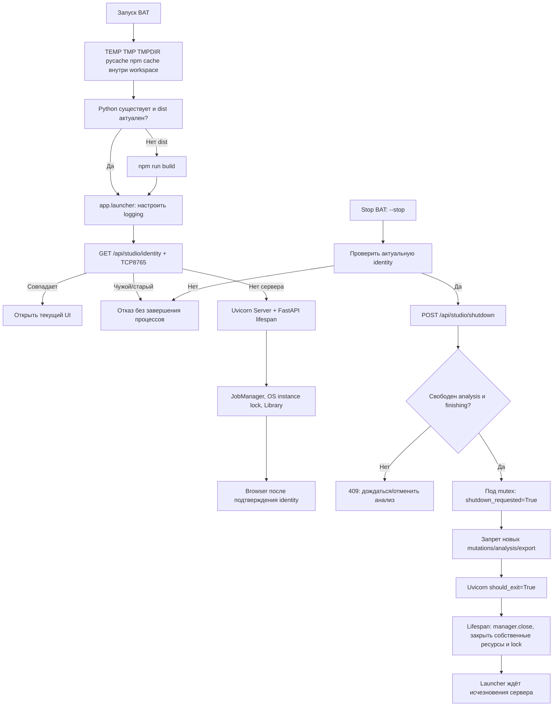

# KADR: запуск, остановка, BAT и диагностика

Проверено 11 октября 2026 года. Этот документ описывает операционный контур приложения; схема обработки видео находится в [architecture.md](architecture.md). Все пути ниже относятся к `F:\new_prodject`.

## Обычная работа

1. Запустить `1_Запустить_Кадр.bat` или `start.bat`. Оба запускают один настоящий Studio на `http://127.0.0.1:8765/studio-edition.html` и работают с одной библиотекой `data`.
2. Сохранить открытой исходную консоль. Повторный запуск открывает существующий проверенный экземпляр, не создаёт второй сервер. Окно повторного запуска может сразу закрыться — сервер продолжает работать в первом окне.
3. Для обработки выбрать локальный провайдер в интерфейсе. Сам запуск UI моделей не загружает и видео не обрабатывает. Готовность интерфейса и наличие всех моделей — разные проверки.
4. После окончания обработки/экспорта запустить `остановить_Кадр.bat`. Свободный сервер штатно завершится. Если анализ идёт, остановка будет отклонена: дождаться окончания или нажать отмену обработки в интерфейсе. Для finishing-экспорта дождаться завершения.
5. Ctrl+C в исходной консоли также закрывает сервер. При активном анализе это прекращает принадлежащий KADR worker, сохраняет статус `interrupted` и оставляет возможность продолжения. После этого сервер нужно запустить снова. Закрытие вкладки браузера само по себе сервер не останавливает.

Если порт принадлежит другому workspace, старому коду или другой программе, launcher отказывает в запуске/остановке. Найти исходную консоль и закрыть её с учётом активной работы. Диагностическая команда `Get-NetTCPConnection -LocalPort 8765 -State Listen | Select-Object OwningProcess` показывает владельца порта, сама ничего не завершает.

## Все пользовательские запускатели

| Файл | Что происходит | Побочные действия/ограничения | Результат |
| --- | --- | --- | --- |
| `1_Запустить_Кадр.bat` | Передаёт управление `start.bat` | Тот же UI/API/data, отдельного приложения нет | Код launcher |
| `start.bat` | Проверяет portable Python; сравнивает четыре Studio public-файла с dist; при необходимости `npm run build`; запускает `app.launcher` | Сборка только при отсутствующем/устаревшем dist. Предпочитает portable tools/node + scripts/npm.cmd, затем существующий npm на PATH. Нужны frontend/node_modules. Первый запуск держит сервер в этой консоли | 0 при штатном выходе; 1 при ошибке BAT |
| `остановить_Кадр.bat` | Проверяет identity, POST штатной остановки, ждёт до 15 секунд | Только собственный актуальный свободный сервер. Чужие процессы и активные задания не завершаются | 0: остановлен/уже отсутствует; 2: отказ/timeout; 1: нет Python |
| `открыть_логи.bat` | Открывает Explorer в `logs` | Только просмотр; не запускает тесты/модели | 0 |
| `setup.bat` | `scripts/setup.ps1`: portable Python, frontend npm ci/build, `scripts/setup.py all` | Это установка/загрузка зависимостей и моделей; сеть и большие файлы. npm cache/temp внутри workspace. Предпочитает portable Node/npm; автоматически Node не скачивает | 1 при ошибке; сообщение об успешной подготовке иначе |
| `ТЕСТЫ/1_ПРОВЕРКА_БЕЗ_ИИ.bat` | Все Python/Studio проверки и технический 180s E2E без ASR/VLM | По умолчанию публикует безопасный отчёт в GitHub test-reports. Для локального запуска передать `-NoUpload` | Код verify runner |
| `ТЕСТЫ/2_ПОЛНАЯ_ПРОВЕРКА_С_ИИ.bat` | То же + реальный 180s фрагмент, Whisper, Qwen 4B, сюжетная Qwen 9B, экспорт/resume | Выбирает источник диалогом или `-RealSource`. По умолчанию публикация; локально `-NoUpload`. Shared budget 1800s для полного AI режима | Код verify runner; TIMEOUT остаётся неуспехом |
| `ТЕСТЫ/3_ПОЛНАЯ_ПРОВЕРКА_DEEPSEEK.bat` | Реальный 180s прогон с local perception и платной DeepSeek story | Загружает сохранённый ключ, требует отдельное UNLIMITED, лимита расходов нет; публикация по умолчанию. В этом аудите не запускался | Код verify runner |
| `ТЕСТЫ/KADR_СОБРАТЬ_ЛОГИ.ps1` | Читает последний real_model_3min и создаёт CSV/JSON/ZIP структурной диагностики | Пользовательский untracked файл сохранён без изменений. Не запускает модели, не публикует. Результат `temp/KADR_DIAGNOSTICS_*` | ZIP или ошибка отсутствия run |
| `scripts/npm.cmd` | Внутренний wrapper existing tools/node/node.exe + npm-cli.js | Используется start/setup/verify перед npm из PATH, cache/npm; передаёт args и exit code | Код portable npm |

`KADR_NONINTERACTIVE=1` отключает паузу трёх тестовых BAT и stop BAT. В тестовых режимах с реальным видео нужен явный `-RealSource`, иначе отсутствие выбранного файла считается ошибкой. В `start.bat`/`setup.bat` пауза при ошибке остаётся интерактивной.

Для проверки без публикации:

```powershell
& '.\ТЕСТЫ\1_ПРОВЕРКА_БЕЗ_ИИ.bat' -NoUpload
& '.\ТЕСТЫ\2_ПОЛНАЯ_ПРОВЕРКА_С_ИИ.bat' -NoUpload -RealSource 'F:\new_prodject\data\imports\episode.mp4'
```

Второй пример запускает реальные локальные модели и может работать долго; это процедура, а не утверждение о выполненной проверке. Для измерений 120/180s используется отдельная процедура в performance-документах, чтобы полный технический suite не смешивался со временем самого видео.

## Схема запуска и остановки



`/api/health` сообщает доступность API, но не доказывает актуальность кода/интерфейса. Launcher использует identity с application/interface/workspace/backend/ui. Наличие моделей отдельно проверяет `config.readiness()`.

После интеграции этого аудита backend fingerprint охватывает все `app/*.py`, а UI fingerprint — все четыре активных Studio dist-файла (HTML, bridge, app JS, CSS). Backend hash фиксируется при импорте процесса: обновление файлов на диске требует перезапуска старого сервера. CLI stop намеренно отказывает старому fingerprint; для такого старого запуска использовать его исходную консоль.

Во время shutdown флаг защищён mutex менеджера. Запуск анализа и finishing повторно проверяют его под этим mutex; OS lock сохраняется до lifespan cleanup. Отказ callback сбрасывает флаг. Это позволяет не принимать новый worker/export в промежутке между запросом остановки и закрытием серверного сокета.

## Где искать ошибки

| Путь | Для чего | Особенности |
| --- | --- | --- |
| `logs/startup.log` | Время вызова start.bat и общие ошибки portable Python/launcher | Не полный дамп консоли и не все сообщения сборки npm |
| `logs/LATEST.txt` | Относительный путь последней диагностической сессии | Последний launcher/reuse/stop/test может заменить указатель; это не обязательно сессия ещё работающего сервера |
| `logs/studio/<session>/session.json` | Начало, тип и PID сессии | UTC, без credentials |
| `logs/studio/<session>/readable-<pid>.log` | Читаемые события/traceback приложения | UTC; искать ERROR/WARNING и job_id в JSONL |
| `logs/studio/<session>/events-<pid>.jsonl` | Структурные события запуска, HTTP, worker, stage | action/status/job_id/stage/elapsed_ms, без HTTP body и UI form values |
| `data/jobs/<job_id>/worker.log` | stdout/stderr worker subprocess | Детальная локальная диагностика; не считать универсально безопасной для публикации |
| `data/jobs/<job_id>/diagnostics/pipeline/timeline.jsonl` | Этапы обработки и model/pipeline события | Вложенные интервалы нельзя просто суммировать |
| `data/jobs/<job_id>/render/**/process_*.log` | FFmpeg stdout/stderr | Причина ошибки экспорта, paths/технические параметры |
| `logs/tests/<run_id>/*.out.txt`, `*.err.txt` | stdout/stderr каждого Run-Check | verify теперь передаёт сюда KADR_LOG_DIR для application structured logs |
| `temp/verification-reports/<run_id>/checks.json` | Итоги проверок | Смотреть FAIL/TIMEOUT и имена стадий; raw report остаётся локальным |
| `temp/verification-reports/<run_id>/real_model_3min/report.json` | Фактический real E2E результат | Отсутствующий/неполный отчёт не считается PASS |

`scrub()` маскирует известные шаблоны credentials, включая JSON/словарные значения с кавычками и пробелами. Это защита операционных logs, а не разрешение публиковать произвольные worker/model/FFmpeg журналы: в них могут быть имена файлов, исходный текст или кадры.

## Подтверждённые дефекты и исправления

| Проблема | Доказательство до исправления | Сделано | Проверка |
| --- | --- | --- | --- |
| Заявленные 30s readiness учитывали только sleep, а не HTTP | Регрессия с медленным mock probe: 60 вызовов вместо 3 | Monotonic deadline, structured startup_timeout | launcher tests |
| Startup exception не сохранялась в app session logs | Mock serve RuntimeError: Logger.exception вызван 0 раз | Запись traceback startup_failed для Exception и неуспешного SystemExit | launcher tests |
| JSON/dict secret значения проходили redaction | Synthetic api_key/password/access_token оставались в scrub | Redaction полного quoted значения, включая escaped quotes | run_logging tests |
| npm cache не направлялся в workspace | start/setup/verify использовали npm без npm_config_cache | cache/npm, TEMP/TMP/TMPDIR до внешних инструментов | Diff + PowerShell parser, установка не запускалась |
| App events verify могли уйти в отдельную studio session | logsDir создавался, KADR_LOG_DIR для subprocess не задавался | verify наследует KADR_LOG_DIR=logs/tests/run_id | Source review; verify целиком не запускался |
| Не было понятной отдельной остановки | Только Ctrl+C и исходная консоль | stop BAT + identity/idle guarded API; без taskkill | Shutdown tests и launcher tests |
| Portable Node/npm существовали, но искался внешний npm.cmd | В tools/node только node.exe + npm-cli.js; Get-Command выбирал E:/nodejs/npm.cmd | scripts/npm.cmd и portable-first PATH для start/setup/verify | Реальные local --version и config get cache; Node24.15.0/npm11.12.1; cache F:/new_prodject/cache/npm |
| Изменение JS/CSS/jobs/worker могло не менять identity | Fingerprint охватывал три backend файла и два UI файла | Координатор расширил backend до app/*.py, UI до четырёх активных assets | Отдельные tests/test_studio_identity.py и проверка current/stale launcher |

Новые тесты первых трёх дефектов действительно дали 3 FAIL на старом коде; после исправлений дали 15 PASS. Расширенная итоговая операционная проверка: **148 passed, 26 subtests passed**, 7.73s, одно предупреждение Starlette/httpx deprecation. Она включала launcher, logging, shutdown, jobs, finishing, API и проверку контрактов verification/story profiles без реального inference.

## Команда регрессионной проверки и ограничения

```powershell
$env:TEMP='F:\new_prodject\temp'
$env:TMP=$env:TEMP
$env:TMPDIR=$env:TEMP
$env:PYTHONPYCACHEPREFIX='F:\new_prodject\cache\audit-pycache'
$env:PYTHONUTF8='1'
$auditPytestBase=Join-Path $env:TEMP ('operations-pytest-'+[guid]::NewGuid().ToString('N'))
& .\tools\python\python.exe -m pytest -q --basetemp $auditPytestBase `
 tests/test_studio_shutdown.py tests/test_launcher.py tests/test_run_logging.py `
 tests/test_jobs.py tests/test_finishing.py tests/test_api.py `
 tests/test_verification_report_contract.py tests/test_cloud_story_full_e2e.py `
 tests/test_fast_local_story.py tests/test_flash_story_budgeted.py
```

При первом запуске расширенного набора sandbox возвращал WinError5 на pytest tmp_path: и в прежнем `temp/pytest-of-Никита`, и в новом уникальном basetemp после `mkdir(mode=0700)`. Повторный запуск без filesystem sandbox, с теми же workspace-only paths, прошёл. Это ограничение среды агента, не доказательство неисправности пользовательского BAT. Права старых папок не изменялись, старые данные не удалялись.

В этом операционном подаудите не выполнялись setup, полный verify, публикация отчётов, DeepSeek и модельный прогон. Реальные UI/start/reuse/stop и измерения выполняет координатор аудита; результаты сохраняются отдельно и должны быть добавлены к итоговому отчёту. Source/tests подтверждают контракты, но сами по себе не доказывают выполнение Windows BAT двойным кликом.

## Что ещё стоит улучшить

- `setup.ps1` автоматически скачивает portable Python, но ещё не скачивает portable Node/npm для чистого checkout. Нынешний workspace использует уже имеющиеся portable Node/npm; если их нет, нужен явно доступный runtime.
- Сборка frontend и сообщения Uvicorn до app logging частично видны только в консоли; `startup.log` ещё не полный безопасный журнал bootstrap/build.
- Identity проверяет активные Studio assets. Отдельный hash HTML/JS/CSS старого диагностического интерфейса пока не входит в этот handshake; при дальнейшей поддержке legacy route определить единый version contract.
- Нет явной пользовательской отмены finishing-экспорта. Штатный stop отказывает, пока export активен; Ctrl+C прерывает его через cleanup.
- Логи не имеют автоматической ротации/retention. `LATEST.txt` показывает последнюю сессию, но не всегда активный сервер. Для долгой эксплуатации полезны отдельные указатели active session и ограничение размера/давности logs.

Архитектурное решение о safe stop: [ADR-0027](../ai/decisions/0027-idle-studio-shutdown.md). Изменение обратимо; форматы пользовательских данных не менялись.

## Дополнительная проверка живого интерфейса и исправления

Координатор открыл реально завершённый job `f328937d` на странице проверки. В DOM были реальные source/short API URL; видео имели duration 1420.221979s / 63.87s и readyState=4, оба воспроизводились (`paused=false`). Browser error/warning массивы были пусты. При этом экран утверждал «Демо: встроенные ролики 7 сек», а кнопка после запуска оставалась «▷ Смотреть». Эти сообщения противоречили фактической работе.

Исправлена только активная Studio Edition: `frontend/public/studio-edition-app.js` и `studio-live-bridge.js`. На дату этого прогона reference HTML ещё существовал; при очистке 13 октября он удалён. Текущий интерфейс — только Studio.

| Подтверждённое несоответствие | Что изменено |
| --- | --- |
| Реальная проверка помечена как встроенное демо | Подпись сообщает о реальных видео и таймкодах сохранённого плана |
| Play/Pause кнопка не отражала состояние media | Слушает play/pause/ended, обновляет текст и aria-label; в compare останавливает воспроизведение при активности любого плеера |
| «Журнал задачи / Имитация сообщений» показывал creation/update summary | Теперь «Сводка статуса / Создание и последнее обновление API»; она не выдаётся за полный технический журнал |
| Этапы назывались stage_progress, хотя строились по stage | Подпись указывает фактически используемый stage |
| API execute помечен «в демо» при реальном POST | Кнопка и подсказка сообщают о локальном сервере и реальных данных |
| Balance/recovery/spending/reset-budget интерфейс отражал удалённый accounting | Retired compatibility routes убраны из активного каталога/видимых кнопок; backend compatibility stubs сохранены |
| «Все части · ZIP» реально вызывал save-videos с выбором папки | Подпись «Все части → папка», отмена выбора папки больше не обозначается успешным сохранением |
| Finishing помечен DEMO/BROWSER при реальных preview/export API | Подпись LOCAL/FFMPEG и пояснение о сохранении правок на сервере |
| Editor обещал maximum90s при planner.MAX_DURATION120s | Максимальная длина части теперь 120s |
| Каталог статуса preview/export использовал demo IDs | Bridge запоминает фактические preview_id/export_id; каталог использует их, preview ограничен выбранным job |
| Импорт API example передавал JSON name/size вместо multipart | Выполнение такого примера отключено с переходом к штатному file-upload действию; также отключены примеры без выбранных сущностей/task IDs |
| API log фиксировал все успешные ответы как 200 | Bridge передаёт actual HTTP status отдельным callback, без изменения body-контракта |
| Sidebar «Сбросить демоданные» реально обновлял server records | В live DOM действие называется «Обновить», title объясняет загрузку свежих данных |

Динамический Node VM regression в `tests/test_production_entrypoints.py` исполняет реальные renderer/transport/bridge функции с mock DOM/media/fetch: проверяет live copy, отсутствие retired route entries, placeholder guards, принадлежность preview текущему job, play/pause/ended, сохранение task IDs и реальный 202 в журнале UI. Сеть, сервер и модели из этого теста не вызываются. На старом UI тест действительно упал на ложной demo подписи; после исправлений **20 passed** для production-entrypoint/verification-contract набора (0.21s). `node --check` обоих JS прошёл. Build и повторную проверку actual DOM после сборки выполняет координатор; в этом подаудите build не запускался.

Кроме UI исправлена устаревшая подсказка verify при отсутствии Python packages: теперь предлагает `setup.bat` / `tools/python`, без создания новой `.venv`.

Ограничения: compare воспроизводит два реальных файла, но это ещё не означает синхронного перехода source между всеми cuts готового Shorts. Сводка статуса не содержит полный timeline/model/FFmpeg журнал; подробные файлы перечислены выше. В active JS остаются унаследованные mock/helper определения и embedded demo bytes, хотя production request идёт через KadrBridge. Их удаление требует отдельного анализа достижимости, особенно fallback аудио и editor composition preview; в этой bounded UI правке они не удалялись.

## Реальная повторная проверка координатора

После исправления закрытых handlers выполнена сборка `npm run build`: TypeScript/Vite завершились с exit 0. Затем `cmd /d /c start.bat` поднял PID 15924 на `127.0.0.1:8765`; readiness и application startup прошли без прежних logging errors. Повторный такой же BAT завершился с exit 0 и сообщением `Reusing current KADR Studio`; PowerShell подтвердил единственный listener с прежним PID 15924.

Активная диагностическая сессия `logs/studio/20261011_124609_15924_b3ca1fb6` действительно содержит события `logging_restored`, `server_start`, HTTP и UI actions. В момент проверки было 61 JSON event, включая 50 HTTP events. `LATEST.txt` после второго launcher указывает уже на его отдельную сессию — это подтверждает описанное ограничение указателя, а не потерю журнала сервера.

После reload собранной Studio повторно проверены каталог, история, сводка статуса и реальный завершённый монтаж. Больше нет demo подписи и ложного ZIP обещания. Кнопка после play показала `Ⅱ Пауза`, после второго клика `▷ Смотреть`; оба real API video были `readyState=4`, сначала `paused=false`, затем `paused=true`. Browser warn/error list пуст в этой проверке. Снимок: [исправленный просмотр](../../temp/local-audit-20261011/studio-review.png).

`cmd /d /c остановить_Кадр.bat` завершился с exit 0 и сообщением об остановке. Исходный BAT сервер подтвердил `Application shutdown complete` / `Finished server process [15924]`, тоже exit 0. Исходные пользовательские задания не запускались, не отменялись и не удалялись ради этих проверок. Проверка start/cancel/retry настоящего worker через UI будет отдельно отмечена только после выполнения в изолированном каталоге.

## Реальный дефект logging при старте BAT

После успешной сборки UI координатор реально вызвал `cmd /d /c start.bat`: сервер стал доступен, но консоль повторяла `ValueError: I/O operation on closed file` в `app/run_logging.py`, `_JsonlHandler.emit`. Из-за этого часть новых JSONL событий не записывалась. Наличие работающего HTTP/UI не означало исправную диагностику.

Причина подтверждена изолированным воспроизведением: launcher сначала создаёт собственные file handlers, а `uvicorn.Config` затем вызывает глобальный `logging.config.dictConfig`. Даже с `disable_existing_loggers=False` Python logging закрывает уже зарегистрированные handlers. Старый `configure_logging` проверял только PID/папку и возвращал прежнюю конфигурацию с закрытым JSONL stream.

Исправление: `configure_logging` отслеживает только два принадлежащих приложению handlers и проверяет, что они ещё присоединены и открыты. Закрытые handles удаляются и создаются заново в append-режиме **той же сессии**, без потери прежних событий/метаданных и без накопления дубликатов. Чужие handlers самостоятельно не удаляются. В `server.main` logging восстанавливается сразу после `uvicorn.Config`, до фактического startup/lifespan; lifespan остаётся дополнительным idempotent guard.

Регрессия `test_logging_reopens_owned_handlers_after_external_dictconfig_or_close` выполняется в отдельных subprocess, чтобы не закрывать pytest capture. Она проверяет три сценария: явный dictConfig, настоящий конструктор uvicorn.Config без запуска сервера, закрытие одного owned handler. События до/после присутствуют один раз и в JSONL, и в readable log; folder сохраняется; stderr не содержит logging errors. Старый код действительно дал FAIL с тем же traceback. После исправления launcher/logging/shutdown/production-entrypoint набор дал **36 passed + 13 subtests** (1.78s), одно прежнее Starlette/httpx предупреждение.

Диагностические fixture-сессии лежат в `logs/tests/logging-reinit-*`. Реальные повторный BAT start, статус сервера и запись `server_start`/HTTP/`server_stop` после ремонта проверяет координатор. Старый уже работающий процесс автоматически новый logging код не получает; его нужно остановить через собственную консоль или согласованный identity запрос и запустить заново. GPU/model benchmark в этом исправлении не перезапускался и его данные не менялись.


## Отсутствующая историческая статистика токенов

В реально завершённом job `f328937d-214f-4978-9508-b075596794b1` отсутствует `data/jobs/<id>/token-usage.jsonl`. Прямой вызов используемого endpoint helper `app.token_usage.summary` подтвердил: version1 возвращает `local/deepseek.calls=0`, `unknown_calls=0`, `all_tokens=0`, без поля `available`. Сам по себе такой ноль не доказывает отсутствие расхода в старом запуске. При этом отчётный helper `token_ledger_summary` уже умеет обозначать отсутствие данных через `available=false`; он не используется экраном процесса.

Активный UI теперь различает данные по сохранённым записям: нет measured/unknown calls → «Нет сохранённых данных о токенах»; есть только ответы без usage → «Статистика токенов не предоставлена»; измеренные и неизвестные ответы вместе → «Известно», а не полный итог «Всего». Провайдер без измеренных calls обозначается «нет данных». Настоящий measured zero (`calls=1,total_tokens=0`) сохраняется как ноль. Подпись панели «Сохранённая статистика ответов моделей» не обещает наличие telemetry в legacy заданиях. API/backend и сохранённые задания этой правкой не менялись.

Node VM regression сначала действительно упал: старый UI выдавал «Локально: 0 · DeepSeek: 0 · Всего: 0 токенов (0 запросов)» для отсутствующего ledger. После исправления `tools/python/python.exe -m pytest -q tests/test_production_entrypoints.py tests/test_verification_report_contract.py` дал **20 passed** (0.17s); `tools/node/node.exe --check` обоих активных JS прошёл. Проверены missing/unknown/mixed/actual-zero варианты. Последнюю сборку и проверку реального исторического job в браузере выполняет координатор; модельные запросы для этой проверки не запускались.


## Проверка существующего сборщика диагностики

Координатор выполнил существующий пользовательский `ТЕСТЫ/KADR_СОБРАТЬ_ЛОГИ.ps1` через `powershell -NoProfile -ExecutionPolicy Bypass`; процесс завершился с **exit 0**. Получен локальный архив [KADR_DIAGNOSTICS_20261011_112517_ab2f6eae_20261011_195601.zip](../../temp/KADR_DIAGNOSTICS_20261011_112517_ab2f6eae_20261011_195601.zip), наличие файла дополнительно проверено (14 848 bytes). Сборщик сообщил **31 сцену, 158 запросов/ответов**. Эти данные относятся к старому DeepSeek запуску с timeout, а не к текущим локальным 120/180s измерениям. Пользовательский PS1 не изменялся; архив никуда не загружался.

## Реальная изолированная UI проверка

Проверка выполнена на loopback8767 с отдельными DATA/JOBS/IMPORTS/SETTINGS/MUSIC_SETTINGS под `temp/ui-audit-20261011`, установленными до импортов приложения. Пользовательская библиотека и музыкальные настройки не изменялись. Сохранён реальный Windows WorkerProcess/Job Object; подменялся только путь bootstrap запуска worker для этого изолированного каталога.

В интерфейсе создана серия с настоящим2s FFmpeg-файлом, выбран ручной provider и отключена музыка. Запуск дал running, отмена на ASR — cancelled; «Подготовить данные» повторно запустила тот же job ID, затем проверенная отмена освободила manager. Возврат к Qwen сменил provider того же остановленного задания на local. Полная обработка этого2s файла не завершалась; эта проверка доказывает start/cancel/retry, а не редакторскую приёмку и не reuse всех стадий.

В том же изолированном задании отдельно экспортирован transport-only пакет. Через настоящий выбор файла импортирован реальный agy smoke JSON; UI показал «Готов к проверке конвейером», Browser warning/error список пуст. Затем кнопка возврата подтвердила local. Реальное использование ответа по аниме и отсутствие повторных4B запросов проверены отдельно настоящим analysis.analyze на сохранённом120s задании:10,347s, один импортированный ответ, ноль повторных4B запросов, следующая независимая проверка экспортирована новым пакетом. Оригинальные Qwen настройки/контрольные точки восстановлены.

[Снимок интерфейса импорта](../../temp/antigravity-smoke-20261011/studio-manual-import.png), [инструкция ручного режима](../antigravity-manual.md).
