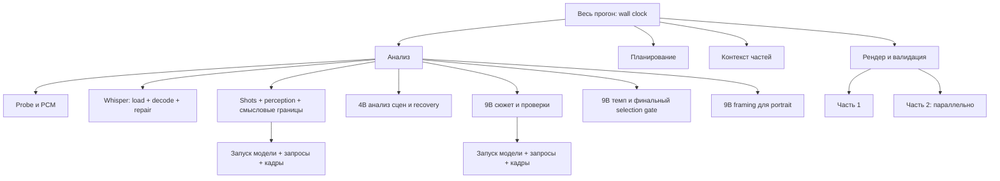

# Производительность KADR: что измеряется и как проверять локальную обработку

Дата аудита: 11 октября 2026. Это описание по исходному коду и протокол измерений; фактические результаты прогонов находятся в отдельном отчёте аудита. Числа конфигурации ниже — ограничения программы, а не измеренная скорость машины.

## 1. Воспроизводимый полностью локальный путь

Основной путь: `scripts.run_production_raw_quality.run(fixture, job, render=True, analysis_provider="local")`. Это прозрачный наблюдатель настоящего `app.pipeline.run_job`, без подмены распознавания, ответов модели, выбора сцен или критериев качества. Для первого запуска `fixture/input.json` содержит только абсолютный путь `source`; отсутствие `transcript` заставляет приложение выполнить Whisper. Каждый исходный прогон получает новый каталог задания.

Модели из `app/config.py`:

| Назначение | Локальный файл | Режим |
| --- | --- | --- |
| Русская речь | `models/whisper-large-v3` | faster-whisper, CUDA `int8_float16`; настоящий CPU `int8` при ошибке CUDA |
| Визуальные сцены и границы | `models/qwen/Qwen3.5-4B-UD-Q4_K_XL.gguf` + `mmproj-F16.gguf` | llama.cpp, без thinking по умолчанию |
| Сюжет, проверки выбора, темп | `models/qwen9/Qwen3.5-9B-UD-Q4_K_XL.gguf` + `mmproj-F16.gguf` | сюжетная сессия с thinking; отдельная сессия темпа без thinking |
| Кадрирование portrait | Та же Qwen 9B | отдельная сессия; для cinema эта стадия VLM пропускается |

`local` не переключается на платный API. Ветка `LocalVision` может только перезапустить ту же модель на CPU. `local_fast_story` — отдельный эксперимент: сюжет на 4B, последующие темп и portrait-кадрирование всё равно на 9B. `local_flash_story`, `local_flash_story_budgeted`, `deepseek`, `deepseek_plan`, `hybrid` не подходят для замера «всё на локалке». Нельзя считать слово `local` в имени Flash-провайдера гарантией локальности: сюжет у него платный.

Доказательства: [выбор провайдера](../../app/vision.py), [последовательность анализа](../../app/analysis.py), [ASR](../../app/inference.py), [настоящий наблюдатель](../../scripts/run_production_raw_quality.py).

### Команды штатных инструментов

Все входы, выходы и окружение остаются в `F:\new_prodject`; рабочая директория — корень проекта, Python — `tools/python/python.exe`.

Для 180 секунд доступны штатные команды; пути исходника и каталога результата нужно задать явно:

```powershell
.\tools\python\python.exe scripts/prepare_real_test_video.py --source F:\new_prodject\data\imports\episode.mp4 --directory F:\new_prodject\temp\audit\source180 --start-seconds 300
.\tools\python\python.exe scripts/full_pipeline_3min.py --mode real --local-provider local --source F:\new_prodject\temp\audit\source180\story-180s.mp4 --directory F:\new_prodject\temp\audit\full180
```

`prepare_real_test_video.py` и `full_pipeline_3min.py --mode real` жёстко требуют 180±0,2 с и аудиодорожку. Режим `offline` использует искусственный testsrc/sine и подготовленные смысловые решения: он проверяет технический рендер, но не является доказательством скорости/качества настоящих Whisper/Qwen.

Для 120 секунд используется настоящий production-наблюдатель, который не фиксирует длительность видео:

```powershell
.\tools\python\python.exe scripts/run_production_raw_quality.py --fixture-dir F:\new_prodject\temp\audit\fixture120 --job-dir F:\new_prodject\temp\audit\job120 --render
```

Предусловия этой команды: файл 120 с создан FFmpeg из реальной серии, проверен FFprobe, а `fixture120/input.json` содержит `{"source":"F:/new_prodject/temp/audit/source120/story-120s.mp4"}`. CLI наблюдателя по умолчанию выбирает `local`. Для сопоставимого эксперимента 120 и 180 секунд вырезаются с одного начала, например 300 с; это сохраняет общий первые 120 с и исключает различие «один пример только заставка, другой диалог». Клипирование входит в подготовку эксперимента, а не во время обработки входа пользователем.

`--transcript` в 180-секундном harness или поле `transcript` в input.json — готовый ASR: распознавание и его ремонт пропускаются. Такой прогон пригоден для сравнения VLM, но не для ответа «сколько длится вся обработка со speech recognition».

### Ограничения времени

| Операция | Ограничение из кода | Следствие |
| --- | ---: | --- |
| ASR subprocess / repair-only | 7200 с | Это верхняя граница ожидания, не нормальное время |
| Загрузка одного VLM сервера | 180 с | Таймаут не означает успешный CPU fallback; fallback загрузки возникает при завершении GPU-процесса |
| Один HTTP-запрос VLM | 240 с socket timeout | При ошибке HTTP ≥500 возможен дополнительный startup и повтор на CPU; сетевой таймаут сам по себе этот fallback не запускает |
| `/tokenize` VLM | 30 с | Проверка контекста отдельно от chat-completions |
| Обычный `media_probe.run_process` | 3600 с по умолчанию | Отдельные извлечения кадров задают меньшую границу |
| Один bounded storyboard кадр | 45 с | Много кадров — много отдельных subprocess |
| Подготовка 180-секундного excerpt | 1800 с | Перекодируется только выбранный фрагмент |
| Полный genuine harness | Общий лимит не задан | Суммарное время не ограничено одним request timeout |

Критерии качества остаются штатными. Падение gate или таймаут — самостоятельный результат: перечислить реально пройденные этапы и не выдавать их за успешный полный монтаж.

## 2. Уровни времени и их смысл



1. **Весь прогон** — monotonic/perf-counter время от вызова pipeline до его результата/ошибки; отдельно есть время прозрачного наблюдателя (включает запись отчётов и хэши экспортов). Подготовка клипа и проверка UI — отдельные строки.
2. **Верхние стадии** `analysis`, `planning`, `part_context`, `rendering` в `runs/*.json` последовательно измеряются `pipeline.py`. Их сумма может быть меньше полного времени: идентификация, финальные записи/архивирование и промежутки не полностью покрыты стадиями. На ошибке planning может не получить завершённый timer; отсутствие поля означает «не измерено», а не 0.
3. **Вложенные интервалы** `Diagnostics.stage` и переходы `report(stage, progress, message)` в timeline перекрываются. Например `scenes` содержит `shot_detection`, `media_perception`, `scene_detection`; `scene_detection` содержит загрузку VLM, кадры и запросы. Эти строки нельзя складывать с родителями или превращать в независимые сектора круговой диаграммы.
4. **Сумма запросов** — полезная нагрузка по вызовам, но не дополнительное время поверх анализа. Даже внутри profiler при CPU retry интервалы вложены: наружный request со статусом `retried` включает внутренний request и перезапуск. Без вычитания вложений сумма может учитывать одно время дважды.
5. **Части рендера** выполняются до двух одновременно. `sum(parts.seconds)` не равно `rendering.seconds`; wall rendering — время критического пути плюс подготовка и публикация. Нельзя суммировать длительности параллельных частей для расчёта общего ожидания пользователя.

Exclusive время родителя: `parent_interval − union(child_intervals)`, с объединением перекрывающихся дочерних отрезков. Вычитать простую сумму дочерних `seconds` неправильно при параллелизме/retry. Для существующих diagnostics нет явных parent-span идентификаторов; до доработки допустимы только inclusive таблицы и отдельные верхние стадии.

## 3. Артефакты и доступные метрики

Все пути в таблице относительны каталогу конкретного задания.

| Артефакт | Что действительно доступно | Ограничение интерпретации |
| --- | --- | --- |
| `observed-outcome.json` | Завершённость gate, wall наблюдателя, количество записанных запросов, ошибка, стабильность исходного кода | Перезаписывается на resume; количество запросов накопительное |
| `runs/<uuid>.json` | Один pipeline-вызов: status, начало/конец, total, stages, render_workers=2, encoder, per-part seconds/cached | История первого и повторных запусков; `timings.json` только последний |
| `diagnostics/pipeline/timeline.jsonl` | Этапы start/end, seconds, ошибки, cache hit/miss, события/сцены | Append-only; фильтровать один diagnostics run_id |
| `diagnostics/pipeline/run.json` | Текущий diagnostics run_id, источник, provider, версии, status | Последнее состояние; UUID отличается от UUID `runs/*.json` |
| `model-performance.jsonl` | Request start/end с id, модель visual4b/story9b, purpose, pages, prompt_chars, max_tokens, thinking, CPU, seconds, usage, finish_reason | Append-only; pipeline run_id и session_id отсутствуют; данные usage/timings опциональны |
| `model-performance.jsonl`: `startup` | Время готовности/ошибки/таймаута сервера, модель, CPU | Нет отдельного startup_start; жёсткое завершение при загрузке может оставить пустой интервал |
| `token-usage.jsonl` | Фактические provider-reported prompt/completion/total tokens, включая ответ с невалидным JSON | Не прибавлять к model-performance tokens: это та же нагрузка; безответные запросы неизвестны |
| `actual-model/request-NNN.json` / `response-NNN.json` | Прозрачный запрос, страницы/хэши, настройки, parsed response или error и latency | Содержат текст/пути: локальные приватные артефакты, не материал публичного отчёта |
| `observed-sessions.json` | Модель/проектор/thinking и initial/new/total requests для сессий observer | Startup нет; recorder считает логические вызовы, profiler может учитывать nested retry |
| `transcript.json` | ASR elapsed_seconds, CUDA/CPU, repair_version/log, words и segments; repair_elapsed_seconds у repair-only | ASR total включает load+decode+repair, исключает импорт процесса, `_setup`, чтение PCM и запись JSON; раздельных load/decode/repair timers нет |
| `diagnostics/pipeline/scene_analysis.jsonl`, `scene_recovery.jsonl` | Принятые решения, признаки uncertainty/recovery | Время восстановления отдельно не гарантировано |
| `diagnostics/pipeline/storyboard.json`, `visual/*.storyboard.json`, `diagnostics/pipeline/frame_backed_scenes.json` | Исходные PTS, количество выбранных кадров/страниц и реальных source frames, роли current/context/recovery | Pages ≠ frames; число страниц не позволяет восстановить количество кадров без metadata |
| `media-evidence.json`, `shots*.json`, `scenes*.json` | Sample count, cut rate, optical-flow coverage, предложения границ, число сцен | Показатели сложности материала, не секундомер исполнения |
| `render/part_NNN/render-info.json`, `render.ffscript`, `output/plan.json` | Фактический encoder, фильтры, число cuts/выходная длительность, layout, субтитры | Encode, subtitles, validation, mux отдельно по времени не выделены |
| `final_quality_gate.json`, `diagnostics/pipeline/summary.json` | Пройденные проверки, выбранные интервалы, итоговые количества | Успешный запуск Python сам по себе не означает качественный экспорт |

Из измеренного provider timing можно вычислять prefill throughput = `sum(prompt_n)/sum(prompt_ms/1000)` и generation throughput = `sum(predicted_n)/sum(predicted_ms/1000)`; если `predicted_n` отсутствует — использовать completion_tokens только при известном predicted_ms. Это уже делает `export_safe_ai_diagnostics.py`. Деление output tokens на весь HTTP wall — другая метрика и не заменяет decode speed. Percentiles считать по завершённым измеренным запросам; явно показывать количество samples, failed, pending, unknown usage, `finish_reason=length` и thinking/CPU запросы. Unknown остаётся неизвестным.

Контекст VLM фиксирован `-c 8192`, `-np 1`, batch256/microbatch128, image tokens256–2048, GPU layers99; thinking добавляет 512 к max_tokens. В отчёт нужно выводить именно эти настройки плюс measured prompt_tokens и completion_tokens. Prompt_chars не является числом tokens; image pages не является точным image token budget. Глобальный story review использует `/tokenize` и сокращает сводки до допустимого объёма; этот token-count HTTP не входит в request profiler.

## 4. Холодный запуск и повторное использование

Для сравнения входов нужно явно различать:

- **Fresh job**: новый каталог задания, Whisper и все необходимые semantic/model/render этапы настоящие. Это холодный application cache; состояние файлового кэша Windows/GPU-драйвера неизвестно. Называть его полностью холодным ОС запуском без отдельной проверки нельзя.
- **Resume job**: тот же источник/настройки/каталог, повторное использование валидированных checkpoints. Считать latency, количество новых model requests, загрузок серверов, `cached_parts`, идентичность MP4/SRT/plan. Кэш чтения не должен считаться новым inference.
- **Partial resume**: повтор после сбоя. Может догенерировать только часть scene chunks/сессий/рендера; накопительные totals не являются затратами одной попытки.

В штатном `full_pipeline_3min.run_real` после успешного genuine запуска выполняется второй pipeline на том же job. Harness проверяет неизменность количества requests, хэшей outputs и все render parts cached. Поэтому `observed-outcome.json`, `timings.json`, `observed-sessions.json` в конце относятся к повтору; первый `runs/*.json` и первый diagnostics run_id необходимо сохранить/выделить.

Обнаруженный и исправленный в рамках аудита дефект [export_stage_timings.py](../../scripts/export_stage_timings.py): exporter суммировал inclusive события всех запусков из append-only timeline, затем делил на wall последнего observer outcome (обычно быстрого resume). На контролируемом примере свежий pipeline1000с/scenes900с плюс resume20с/scenes0,1с давали несопоставимые агрегаты. Теперь `real_production` выделяет первый pipeline-вызов и берёт denominator из его собственного pipeline end; при незавершённом первом вызове wall/% остаются неизвестными. История `production_invocations` сохраняется отдельно. Legacy timeline без run_id ограничивается первым блоком между pipeline starts. Фактическая проверка: регрессии воспроизведены до исправления; 7 тестов timing/safe exporter прошли после исправления.

В отличие от исправленного блока стадий, `model_performance`, `model_inference`, token ledger в стандартном exporter по-прежнему описывают весь каталог задания. Для специального benchmark сохранять offsets JSONL/request indices до каждой попытки и snapshot outcome/timings после неё. Diagnostics.run_id и timings.run_id разные: при текущем формате сопоставлять через времена начала/конца, а не равенство UUID.

## 5. Вероятные узкие места: доказательства и нужные измерения

Это гипотезы по реализации; ранжировать их по фактическим секундам можно только после genuine прогона.

| Наблюдение по коду | Возможная цена | Как подтвердить | Вариант улучшения после проверки |
| --- | --- | --- | --- |
| `analysis.analyze` открывает отдельные vision_session для boundaries, scenes, thinking story, non-thinking pacing, дополнительно portrait focus | Несколько загрузок одного 4B/9B и освобождений памяти даже на коротком видео | Startup count/sum по моделям, session timeline, доля загрузок | Session reuse в пределах одной модели/режима при обязательном освобождении VRAM перед сменой модели; отдельное архитектурное решение |
| Boundary session создаётся до проверки `scene_checkpoint`, даже если scenes/events позднее cache hit | Resume может загрузить4B при нулевом новом chat request | Resume startup events vs requests/cache events | Сначала проверить cache identity, затем лениво открыть модель при cache miss; не обходить semantic invalidation |
| `LocalVision.start`: `--no-cache-prompt`, `--cache-ram 0`; `query`: cache_prompt=False | Повторный prefill общих инструкций/соседнего контекста | Prefill ms/tokens по purpose, доля prefill в latency | Проверить корректный ограниченный prompt-cache для session; не смешать чужие scene inputs/quality identity |
| `analyze_scenes` и story refinement выполняют queries последовательно; `-np1` | Суммарное время растёт с количеством сцен/chunks и проверок, а не только с секундами видео | Requests/chunks/recovery по стадиям, latency percentiles, сравнить первые общие120с | Сократить доказанно избыточные проверки через валидный cache; параллелизм только с бюджетом VRAM и неизменным качеством |
| `bounded_storyboard._source_times` делает FFprobe по реальным frame PTS; `_frame` запускает FFmpeg на отдельный кадр | Process startup, seek/GOP decode, file writes/hash могут доминировать вне inference | Hook source_times/frame, subprocess count, seconds на кадр, cache hit ratio | Batch decode нескольких требуемых PTS с сохранением source ownership/PTS доказательств |
| `production.sequence_sheet` последовательно делает OpenCV seek/read для context (до36) и трёх точек каждой unit | Повторное декодирование одного GOP и кадра в смежных проверках | seek/read wall, actual frame count, совпадающие timestamps/cache | Совместный frame store и чтение по времени; сохранить идентификацию исходника/PTS |
| `media_evidence` decode sampling около0,2с, grayscale/embeddings/Farneback, плюс raw cut points | CPU/диск расход пропорционален числу sampled frames; отдельный video pass | _video wall, images count/bytes, CPU samples; motion coverage | Пакетное хранение/обработка; менять плотность только после проверки gate quality |
| `media_evidence._audio` снова извлекает16kHz PCM с PTS, когда ASR audio.wav уже есть | Второй audio decode | audio_prepare vs perception_audio wall/bytes | Возможность reuse только если сохранены проверенные PTS выбранного stream; WAV без PTS не эквивалентен автоматически |
| Источник хэшируется observer, analysis, media_evidence и harness; кадры проверяются по SHA256 на cache hit | Resume не нулевой по I/O даже без запросов | hash/read wall, байты source и images, disk throughput | Централизовать fingerprint на immutable source, сохранить проверку изменений/повреждений |
| Whisper beam5/word timestamps, VAD, затем bounded repair повторяет decode подозрительных35с окон | Speech total зависит от количества repair, fallback CPU может резко увеличить время | ASR total/device, repair candidates/accepted; отдельные load/decode/repair hooks | Сначала локализовать проблемные окна/VAD; менять параметры только с качественной ASR регрессией |
| `media.render_part` несколько входов на cuts, blur/scale/ASS, NVENC либо CPU medium4threads; две parts параллельно | Encoder не ускоряет CPU фильтры/входной decode; при NVENC error может повториться работа на libx264 | Parts seconds/actual encoder, cuts count, render wall, CPU/GPU samples | Оптимизация filter graph/декода, concurrency по ресурсам; не только переключатель encoder |
| Render part timer включает `validate_export`, sidecar и публикацию | Нельзя назвать всё время part временем encode | Hook media.run_command, media.validate_export, write_ass/write_srt | Разнести encode/validate/mux/sidecar и повтор NVENC→CPU в spans |

Доказательства реализации: [analysis.py](../../app/analysis.py), [vision.py](../../app/vision.py), [scene_analysis.py](../../app/scene_analysis.py), [bounded_storyboard.py](../../app/bounded_storyboard.py), [production.py](../../app/production.py), [media_evidence.py](../../app/media_evidence.py), [inference.py](../../app/inference.py), [media.py](../../app/media.py), [pipeline.py](../../app/pipeline.py).

## 6. Что добавить в инструментирование

Минимальный полезный набор без изменения алгоритма:

1. Одни `benchmark_attempt_id`, `pipeline_run_id`, `session_id`, `span_id`, `parent_span_id` во всех timing/model/resource records; monotonic start/end и UTC только для корреляции. Явные startup_start/end и request_attempt_id/retry_parent_id. Не писать prompt/ответы в общие метрики.
2. Audio preparation/probe/source hash; ASR subprocess total. Для раздельных ASR load/decode/VAD/repair нужны hooks внутри отдельного `app.inference` subprocess: parent monkeypatch не переносится в новый Python. До этого назвать ASR total честно и вывести repair candidate counts.
3. Storyboard extraction: PTS-probe, FFmpeg startup/seek/decode, frames/pages count, уникальные source timestamps, current/context/recovery counts, cache hits и file bytes. `LocalVision.token_count` — отдельный служебный HTTP timer.
4. Периодические resource samples с PID/parent PID и этапом: CPU total и tree, RSS/peak RSS, RAM available, GPU utilization, GPU VRAM used/peak, disk I/O/bytes. Частота примерно1с, overhead sampler измерить отдельно. Общая VRAM `nvidia-smi` без PID attribution не доказывает память именно модели; host RAM и VRAM не смешивать.
5. Render per-part start/end, encoder probe, выбранный и фактический encoder, retry, encode/validation/subtitles/publication wall, количество cuts/кадров, output bytes/duration, effective FPS и output seconds per wall second. FPS вычислять из фактического числа выходных кадров и encode time; из source fps alone это не измерение encode speed.
6. Fresh/resume/cache-hit counters с уровнями audio/ASR/shots/perception/boundaries/scene chunk/story/events/plan/render; separate first-pass и resume snapshots, а также failed/pending этапы.

Без дополнительного инструментирования RAM/VRAM/CPU load, peak memory, TTFT, queue wait, image-encoder time и отдельное время repair не измеряются штатным profiler. Их нельзя заполнять нулями или выводить из filenames/log labels. HTTP latency включает сериализацию изображения/base64, roundtrip и JSON parsing; это не pure GPU inference.

В ходе аудита добавлен [benchmark_local_pipeline.py](../../scripts/benchmark_local_pipeline.py): genuine production-наблюдатель для120/180с со fresh/resume snapshot в `job/benchmark/<phase>`, progress occupancy, ASR subprocess/audio/media timers, model startup/teardown и cooperative deadline. Он снимает CPU/RAM всей системы и состояние первого GPU через `nvidia-smi` с паузой2с между опросами (фактический шаг больше на длительность самого опроса). Эти resource samples включают другие приложения; measured peak — максимум зафиксированных samples, не аппаратный максимум процесса модели. Таймер wrapper startup тоже может быть вложенным при GPU→CPU. Итоговый summary wall включает завершение sampler и сохранение snapshots; для собственного времени production брать timings/observed-outcome snapshot. Stage occupancy — последовательное время между пользовательскими сообщениями о стадиях, а не детализация всех внутренних процедур. Raw phase snapshots JSONL остаются накопительными: фильтр по started time/offset нужен при resume.

## 7. Формат итоговых таблиц и графиков

Для каждой попытки: input_seconds, source size/resolution/fps/audio stream, model/projector identity и versions, provider, layout, ASR device/repair counts, cache policy, hardware, status/gate, wall_seconds и `RTF = wall_seconds/input_seconds`. Эти настройки нужны, чтобы результат120 и180с был сравнимым.

Выводить отдельно:

- Таблица120с fresh /180с fresh /120с resume: total, prepare, ASR, shots, perception, boundaries, visual scene understanding, story, pacing/gate, framing, planning, part context, render/validation; пропущенный этап обозначать «не выполнялся», неизвестный «не измерено».
- Горизонтальные bars по верхним последовательным этапам; Gantt вложенных intervals и параллельных render parts; не складывать inclusive durations.
- Модели×purpose: startup count/time, requests logical/attempts, latency P50/P90/P95, prefill/decode throughput, tokens, image pages/actual frames, failed/retried/pending/length, CPU/thinking.
- CPU/RSS/VRAM time series с границами стадий и отдельных model starts; cache resume latency и новые requests/bytes отдельно.
- Сложность входа: shots/scenes/chunks/unit count, speech words/sec, cut rate, recovery ratio, selected/output duration и cuts. Если120 и180с имеют разное число сцен/recovery, отношение времени не обязано быть1,5.

Один запуск каждой длительности — наблюдение на выбранном фрагменте и текущей машине. Он не даёт статистического среднего всей серии, а percentile при малом числе запросов следует показывать вместе с sample count. Повторные fresh jobs нужны только для исследования вариативности; cache-resume повтор не заменяет fresh повтор.

## 8. Проверенный portable runtime и targeted tuning после baseline

Во время первого120с baseline readonly-проверки `tools/llama/llama-server.exe --version`, `--help` и `--list-devices` установили:0.5.0-dev, build11316, commit2232bc8b5; доступен Vulkan0 на RTX5060Ti. В portable llama-каталоге есть ggml-vulkan.dll, CUDA backend DLL отсутствует. Это отдельный VLM backend; Whisper по-прежнему сообщает device=cuda. Проверки help/version/devices не запускали модель и не меняли её параметры.

В native log120с наблюдался отказ auto-fit при явно заданном n_gpu_layers99; затем сервер успешно загрузил9B и начал ответы. Следовательно abort относится к подбору параметров, а не к всему inference-серверу. Локальный help определяет --fit как изменение только незаданных аргументов, defaulton, margin1024MiB, минимальный разрешённый для автоматического подбора context4096. KADR фиксирует и layers99, и context8192. Текущий upstream [common/fit.cpp](https://github.com/ggml-org/llama.cpp/blob/master/common/fit.cpp) также проверяет явное число GPU layers и прекращает подбор при таком ограничении. Exact исходник установленного commit получить через web не удалось: upstream служит подтверждением логики, а конкретное поведение установленного бинарника подтверждено его help и локальным warning.

Промежуточное измерение первого9B `choose_units`120с baseline: wall115,6337с,2456 input tokens,649 generated tokens, prefill7,634236с и decode107,872525с. Это6,016 generated tokens/s; decode занимает примерно93,3% HTTP wall. Значит конкретный медленный запрос тратит время преимущественно на генерацию. Второй запрос:104,9984с wall,618 generated tokens за98,538801с decode. Эти две записи не заменяют результаты целой попытки и не объясняют аппаратную причину медленной генерации.

Большая system RAM, VRAM sample около6,7GiB и отсутствие CPUfallback не доказывают Windows shared-VRAM spill, полное offload всех слоёв, OOM или ограничение GPU конкретной причиной. Auto-fit мог не уложиться в целевой запас, даже если занятая VRAM позднее ниже всей VRAM. Для ответа нужны фактические backend buffer/offload данные и атрибуция памяти процессу, которых текущая verbosity3 не показала.

После сохранения неизменённого baseline следующий отдельный эксперимент:

1. То же видео, модель, projector, context8192, layout, gate и sampler; один изменённый фактор: авто-подбор GPU layers вместо жёстких99. Сохранить resolved layer placement/буферы, startup, decode throughput, tokens, качество выбора, CPU/RAM/VRAM. --fit off лишь уберёт подбор и не является исправлением нехватки памяти. Уменьшение context — отдельный эксперимент, поскольку меняет допустимый semantic payload.
2. Если первый шаг не объясняет медленную9B, отдельно сравнивать backend/Flash Attention/KV cache dtype. Local help: flash-attn auto, K/V cache defaultf16. Эти defaults не доказывают фактически выбранную Flash Attention; нужен подробный startup log. Менять portable backend/версию — самостоятельная dependency-задача с откатом, не правка живого baseline.
3. Отдельный quality A/B image-min256→1024 при сохранённом максимуме2048. Native warning касается Qwen-VL grounding; upstream [issue16842](https://github.com/ggml-org/llama.cpp/issues/16842) обсуждает resize и правильные координаты. На montage board больше image tokens может сохранить детали/надписи/лица, но увеличивает память и prefill. Это гипотеза: проверить retained ranges и portrait framing на реальных кадрах, а не объявлять256 причиной уже доказанного неверного анализа.

В sanitized отчёте native warnings представлены allowlisted флагами/количеством, без сырого лог-текста. vision.log использует относительное время каждого server startup, поэтому счётчики относятся ко всему заданию на момент экспорта; для fresh/resume атрибуции в будущем нужны offsets или phase snapshots этого лога.

Дополнительное промежуточное evidence120с:35 shots →12 semantic scenes →12 semantic parent events →52 technical chunks →52 announced story-refinement work items. Parent checkpoints в `visual/event_NNNN.json` подтверждают количество chunks; exact шаблон progress `Сокращение по репликам: сцена N из M` подтверждает размер текущего story workload. Это не52 итоговых событий: `scene_refinement.refine_scene_story` разворачивает chunks в children для настоящей9B обработки, затем `_merge_parent` возвращает их к12 родителям. Поэтому короткая длительность120с сама по себе не ограничивает число медленных thinking-запросов. Для последующего улучшения измерять повторную проверку уже подтверждённых единиц/chunk boundaries и стоимость каждой проверки; сохранять source-grounded критерии, не ускорять путём неподтверждённого объединения и ослабления gate.

RTF/time-per-input-minute failed или timed-out попытки относятся к наблюдённому времени до прерывания, а не к скорости завершённого монтажа. Если render не достигнут, отдельное измерение renderer на историческом настоящем plan — самостоятельный технический fixture с собственным status и timer; его нельзя подставлять вместо отсутствующего этапа genuine120/180с E2E. В текущем baseline layoutcinema/captionsclassic, поэтому отдельный9B portrait-focus условно не требуется.

## Целевой бюджет

После первых исторических попыток пользователь задал предел30мин для180с исходника. Benchmark по умолчанию и полный AI verify теперь ограничены1800с; timeout остаётся неуспехом, не готовым монтажом. Сами исторические manifest/results с лимитом3600с сохранены без изменения. Скорость пока не укладывается в требование; сокращение лимита предотвращает новый часовой прогон, но не ускоряет алгоритм.
