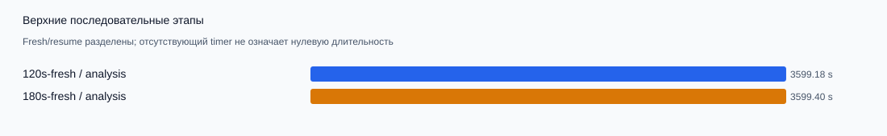
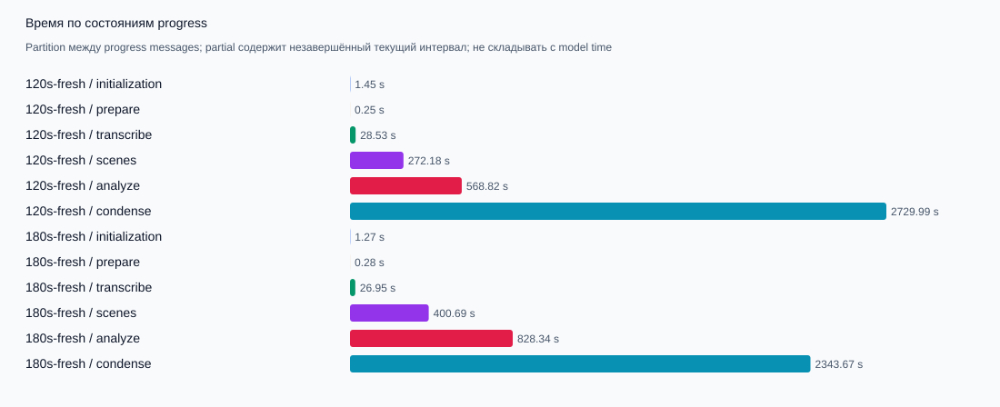
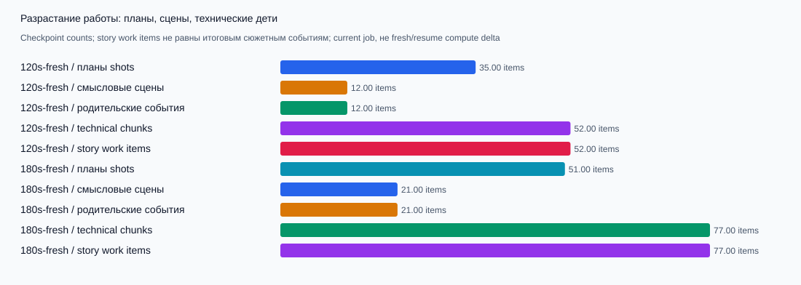
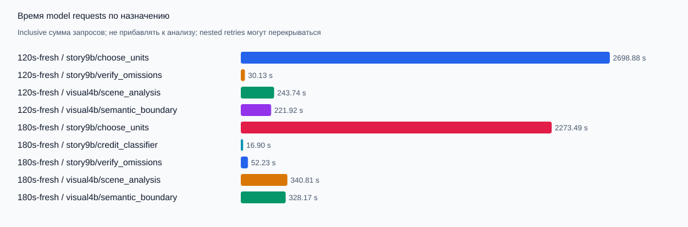
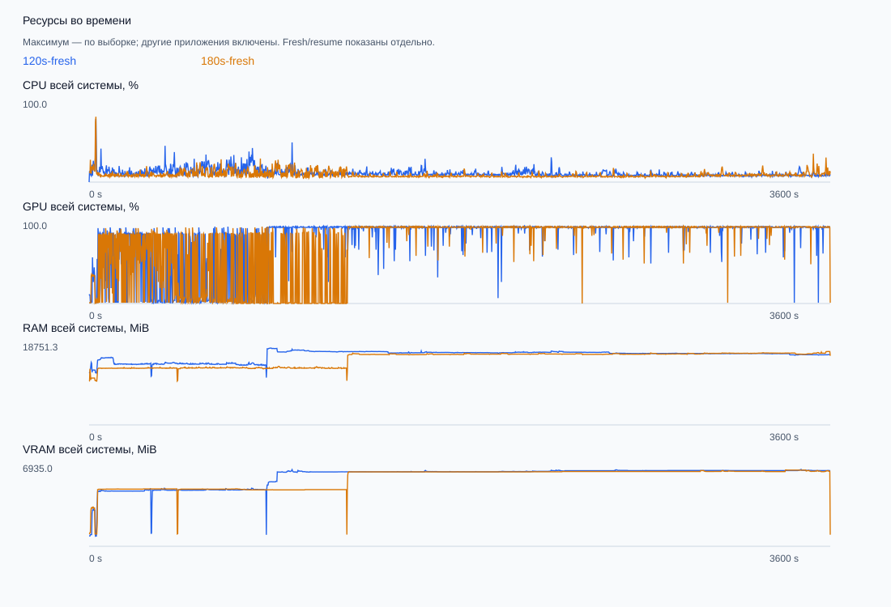
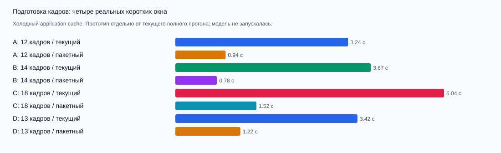

# Локальные замеры обработки KADR

Статус отчёта: **все первые попытки завершены**.

Целевой предел пользователя для 180 секунд исходника — **30 минут (1800 с)**. Исторические попытки ниже получили лимит 3600 с до уточнения требования; обе не завершили монтаж. Это провал по скорости, а не допустимое время обработки. Новые benchmark-запуски по умолчанию ограничены 1800 с.

Провайдер local: настоящий Whisper large-v3, Qwen3.5 4B и 9B, штатные критерии качества. Подготовка видео вынесена из времени обработки. Ошибка или таймаут означает незавершённый полный монтаж; измеренные предыдущие этапы остаются полезными. Условия: layout=cinema, caption_style=classic, ASR распознаётся заново на fresh. Portrait focus9B для этого layout не требуется.

Замеры выполнены с диагностическим observer: он хэширует изображения, сохраняет запросы/ответы и schema, а sampler опрашивает ресурсы. Этот overhead внутри production отдельно не измерен; время не является uninstrumented baseline. Разница observer и pipeline wall не равна всему overhead.

| Вход / попытка | Статус | Полный результат | Pipeline, с | Observer, с | RTF | с на минуту входа | Подготовка отдельно, с |
| --- | --- | --- | ---: | ---: | ---: | ---: | ---: |
| 120s-fresh | timeout | нет | 3599.99 | 3600.58 | 29.99 | 1799.45 | 7.05 |
| 180s-fresh | timeout | нет | 3600.04 | 3600.58 | 20.00 | 1199.93 | 10.40 |

RTF = секунды pipeline / секунды входа. Например RTF10 означает десять минут обработки одной минуты видео. Для failed/timeout это незавершённая попытка до прерывания: её RTF не является скоростью готового монтажа. Наблюдённое время — нижняя граница полного времени при продолжении оставшейся работы. Нельзя сравнивать такой RTF со скоростью completed как равнозначный результат. Benchmark summary включает остановку sampler и snapshots; его wall отличается от pipeline/observer. Fresh означает новый application cache; кэш диска Windows не сбрасывался.

| Попытка / checkpoints | Shots | Semantic scenes | Parents | Technical chunks | Story work items announced |
| --- | ---: | ---: | ---: | ---: | ---: |
| 120s-fresh | 35 | 12 | 12 | 52 | 52 |
| 180s-fresh | 51 | 21 | 21 | 77 | 77 |

Это разрастание числа технических задач. Story work items объединяются обратно в semantic parents; checkpoint count не равен числу завершённых9B запросов.

## Каждый этап и состояние попытки

### 120s-fresh

Статус: timeout; последняя стадия: condense; ошибка: InterruptedError; final gate: нет результата.

| Верхняя стадия | Секунды | Доступность |
| --- | ---: | --- |
| analysis | 3599.18 | measured |
| planning | не измерено | unfinished_or_not_reached |
| part_context | не измерено | unfinished_or_not_reached |
| rendering | не измерено | unfinished_or_not_reached |

ASR subprocess: **28.52 с**; child load+decode+repair: **27.19 с**; устройство: cuda; repair candidates/accepted: 0/0.

| Состояние progress | Секунды occupancy | Частично |
| --- | ---: | --- |
| initialization | 1.45 | нет |
| prepare | 0.25 | нет |
| transcribe | 28.53 | нет |
| scenes | 272.18 | нет |
| analyze | 568.82 | нет |
| condense | 2729.99 | нет |

Occupancy делит время между сообщениями progress и включает внутренние этапы. Это отдельное представление wall, его нельзя прибавлять к верхним стадиям или model timings.

| Вложенная диагностика | Секунды inclusive | Незавершено | Cache hit/miss |
| --- | ---: | ---: | --- |
| pipeline | 3599.99 | 0 | 0/0 |
| prepare | 0.25 | 0 | 0/0 |
| transcribe | 28.53 | 0 | 0/0 |
| scenes | 272.18 | 0 | 0/0 |
| shot_detection | 1.64 | 0 | 0/1 |
| media_perception | 4.41 | 0 | 0/0 |
| scene_detection | 264.55 | 0 | 0/1 |
| semantic_boundary | 222.48 | 0 | 0/54 |
| analysis | не измерено | 0 | 0/1 |
| analyze | 568.82 | 0 | 0/0 |
| scene_analysis | 413.17 | 0 | 0/64 |
| story_refinement | 2729.59 | 0 | 0/1 |
| condense | 2729.38 | 0 | 0/0 |

| Модель / назначение | Попытки / pending / failed | Latency P50 / P95, с | Input / output tokens | Prefill / decode, tokens/s | Pages | CPU |
| --- | --- | --- | --- | --- | ---: | ---: |
| story9b/choose_units | 26/0/1 | 105.00/115.63 | 54204/15755 | 388.26/6.31 | 26 | 0 |
| story9b/verify_omissions | 1/0/0 | 30.13/30.13 | 2288/146 | 382.48/6.10 | 1 | 0 |
| visual4b/scene_analysis | 54/0/0 | 4.42/5.42 | 111055/15584 | 2339.70/82.66 | 76 | 0 |
| visual4b/semantic_boundary | 57/0/0 | 4.02/4.42 | 83134/13894 | 2387.94/77.22 | 60 | 0 |

| Загрузка модели | Попыток | CPU | Сумма измеренных попыток, с |
| --- | ---: | ---: | ---: |
| story9b | 1 | 0 | 11.62 |
| visual4b | 2 | 0 | 8.12 |

Model request attempts: 138; nested retried spans: 0. Request latency — inclusive; при retry внешнее время содержит внутреннюю попытку и startup. Tokens — только reported usage завершённых HTTP-ответов; pending/unknown не оценивались. Pages не равны frames. ASR import/load/decode/repair отдельно не выделены.

Render: частей зафиксировано 0; cached 0; actual encoders: {}. Сумма per-part секунд не является wall при параллельном рендере.

Сложность материала по доступным checkpoints: shots=35, scenes=12, final events=не измерено, semantic parent events=12, technical chunks=52, story refinement work items announced=52, perception samples=631, реальных source video frames=2878.0; storyboard slots={"current": 585, "context_only": 44, "legacy_overview": 643, "recovery_current": 14}, уникальных source times=1235, page slots=101. План: parts=не измерено, cuts=не измерено, output=не измерено с. Это состояние checkpoint, а не число заново вычисленных кадров конкретной попытки. Work items — технические дети смысловых сцен: после проверки они объединяются обратно в родителей; это не количество итоговых сюжетных событий. Индекс announced означает начало пункта, а не его завершение.

### 180s-fresh

Статус: timeout; последняя стадия: condense; ошибка: InterruptedError; final gate: нет результата.

| Верхняя стадия | Секунды | Доступность |
| --- | ---: | --- |
| analysis | 3599.40 | measured |
| planning | не измерено | unfinished_or_not_reached |
| part_context | не измерено | unfinished_or_not_reached |
| rendering | не измерено | unfinished_or_not_reached |

ASR subprocess: **26.94 с**; child load+decode+repair: **26.39 с**; устройство: cuda; repair candidates/accepted: 0/0.

| Состояние progress | Секунды occupancy | Частично |
| --- | ---: | --- |
| initialization | 1.27 | нет |
| prepare | 0.28 | нет |
| transcribe | 26.95 | нет |
| scenes | 400.69 | нет |
| analyze | 828.34 | нет |
| condense | 2343.67 | нет |

Occupancy делит время между сообщениями progress и включает внутренние этапы. Это отдельное представление wall, его нельзя прибавлять к верхним стадиям или model timings.

| Вложенная диагностика | Секунды inclusive | Незавершено | Cache hit/miss |
| --- | ---: | ---: | --- |
| pipeline | 3600.04 | 0 | 0/0 |
| prepare | 0.28 | 0 | 0/0 |
| transcribe | 26.95 | 0 | 0/0 |
| scenes | 400.69 | 0 | 0/0 |
| shot_detection | 2.28 | 0 | 0/1 |
| media_perception | 6.36 | 0 | 0/0 |
| scene_detection | 390.47 | 0 | 0/1 |
| semantic_boundary | 329.40 | 0 | 0/82 |
| analysis | не измерено | 0 | 0/1 |
| analyze | 828.34 | 0 | 0/0 |
| scene_analysis | 594.85 | 0 | 0/98 |
| story_refinement | 2343.30 | 0 | 0/1 |
| condense | 2343.11 | 0 | 0/0 |

| Модель / назначение | Попытки / pending / failed | Latency P50 / P95, с | Input / output tokens | Prefill / decode, tokens/s | Pages | CPU |
| --- | --- | --- | --- | --- | ---: | ---: |
| story9b/choose_units | 23/0/1 | 97.65/104.27 | 46922/13757 | 408.98/6.68 | 23 | 0 |
| story9b/credit_classifier | 2/0/0 | 8.04/8.86 | 1198/84 | 296.51/6.70 | 2 | 0 |
| story9b/verify_omissions | 1/0/0 | 52.23/52.23 | 2311/311 | 415.67/6.68 | 1 | 0 |
| visual4b/scene_analysis | 79/0/0 | 4.22/5.22 | 162185/22360 | 2353.51/85.64 | 121 | 0 |
| visual4b/semantic_boundary | 86/0/0 | 3.82/4.42 | 125541/20710 | 2421.35/78.19 | 90 | 0 |

| Загрузка модели | Попыток | CPU | Сумма измеренных попыток, с |
| --- | ---: | ---: | ---: |
| story9b | 1 | 0 | 6.08 |
| visual4b | 2 | 0 | 8.09 |

Model request attempts: 191; nested retried spans: 0. Request latency — inclusive; при retry внешнее время содержит внутреннюю попытку и startup. Tokens — только reported usage завершённых HTTP-ответов; pending/unknown не оценивались. Pages не равны frames. ASR import/load/decode/repair отдельно не выделены.

Render: частей зафиксировано 0; cached 0; actual encoders: {}. Сумма per-part секунд не является wall при параллельном рендере.

Сложность материала по доступным checkpoints: shots=51, scenes=21, final events=не измерено, semantic parent events=21, technical chunks=77, story refinement work items announced=77, perception samples=938, реальных source video frames=4316.0; storyboard slots={"current": 862, "context_only": 80, "legacy_overview": 1030}, уникальных source times=1921, page slots=158. План: parts=не измерено, cuts=не измерено, output=не измерено с. Это состояние checkpoint, а не число заново вычисленных кадров конкретной попытки. Work items — технические дети смысловых сцен: после проверки они объединяются обратно в родителей; это не количество итоговых сюжетных событий. Индекс announced означает начало пункта, а не его завершение.

## Модель и ресурсы

Машина: Intel Core i5-12600KF; физических ядер 10.0, логических 16.0. Python 3.12.14, Node 24.15.0, FFmpeg 8.0.1.

| Попытка | GPU | Samples | CPU mean/peak, % | RAM sample peak, MiB | VRAM sample peak, MiB |
| --- | --- | ---: | --- | ---: | ---: |
| 120s-fresh | NVIDIA GeForce RTX 5060 Ti | 1757 | 11.69/82.03 | 18751.31 | 6935.00 |
| 180s-fresh | NVIDIA GeForce RTX 5060 Ti | 1758 | 9.57/85.04 | 17926.16 | 6883.00 |

Ресурсы измерены для всей системы, включая другие приложения. Peak означает максимальный sample; между samples возможен более высокий пик. Mean — среднее по samples, не интеграл времени. PID-specific RSS/CPU/VRAM, TTFT, очередь, image encoder, ASR split и encode/validation split пока отсутствуют.

## Предупреждения portable llama.cpp и следующий эксперимент

| Вход | Auto-fit заблокирован explicit GPU layers | Qwen grounding image minimum | Idle cache disabled | Nonconsecutive positions |
| --- | ---: | ---: | ---: | ---: |
| 120 с | 1 | 3 | 3 | 2266 |
| 180 с | 1 | 3 | 3 | 3176 |

Это allowlisted счётчики всего vision.log задания на момент экспорта; per-phase attribution отсутствует. Сырые строки не публикуются. Auto-fit abort завершает подбор параметров, а не обязательно сервер: baseline действительно продолжал запуск и ответы. Указанные `-ngl99` и `-c8192` фиксируют настройки, которые штатный `--fit` может менять только если они не заданы. Медленная9B требует отдельного A/B: сначала auto GPU layers при том же контексте8192, модели, исходнике и gate, с детальными buffer/offload логами и throughput; затем отдельно image-min256→1024 с оценкой выбранных диапазонов/кадрирования и увеличения image tokens. Warning о grounding — повод проверить качество, а не доказательство неверного анализа. Нельзя выводить Windows shared-VRAM spill из одного предупреждения, system RAM или CPUfallback=false.

Локально проверенный portable runtime использует Vulkan0; Whisper использует отдельный CUDA backend. Исходные параметры baseline не изменялись.

Данные: [JSON](measurements/local-benchmark.json), [попытки CSV](measurements/attempts.csv), [этапы CSV](measurements/stages.csv), [модели CSV](measurements/models.csv), [resources CSV](measurements/resources.csv). Методика: [performance-design.md](performance-design.md).

Sanitized экспорт не содержит prompt, ASR text, paths источников, raw response, текст исключений или произвольные строки из console.log. Повторный запуск генератора после завершения обеих попыток заменяет предварительные значения окончательными.

## Ускорение подготовки кадров: отдельный прототип, 12 октября

Четыре коротких окна реального источника сравнивались с текущим `bounded_storyboard` и изолированной пакетной версией. Вместо отдельного FFmpeg на каждый холодный кадр прототип извлекает близкие кадры одним декодером, проверяет фактические PTS и хэши; для разреженных кадров оставляет отдельные seek. Локальная модель не запускалась. Текущий полный прогон использует исходный код, чтобы сохранить совместимость его контрольных точек.

| Окно | Длина, с | Кадры | Текущий cold, с | Пакетный cold, с | Декодеров: текущий → пакетный | Точные PTS, кадры и страницы |
|---|---:|---:|---:|---:|---:|---|
| A |3,922|12|3,2400|0,9430|12 → 1|совпали|
| B |4,820|14|3,6653|0,7796|14 → 1|совпали|
| C |6,761|18|5,0403|1,5202|18 → 1|совпали|
| D |2,010|13|3,4156|1,2199|13 → 1|совпали|

Warm-cache не запускал декодеры в обоих вариантах. Прототип прошёл прежние 12 проверок/18 subtests и дополнительные 15 проверок с реальным FFmpeg: дубли выбранных PTS, разреженный seek, подмена PTS, отмена до публикации и ремонт индексов пакетного кэша. Дополнительные 15 включают прежние тесты базового fixture; это не 27 независимых случаев. Ошибочный пакет не публиковал кадры или страницу.

Это измерения отдельных окон, а не ускорение всего монтажа. Windows disk cache не сбрасывался; замеры шли на компьютере с продолжающимся основным прогоном. Смена способа подготовки кадров не уменьшает число LLM запросов. Внедрение ожидает окончания текущего задания. Числовые данные: [JSON](measurements/frame-preparation.json), [CSV](measurements/frame-preparation.csv).

Структурный подсчёт текущей полной серии: 129 смысловых сцен, 510 технических фрагментов, 132 возможные пары внутренних соседних фрагментов. Если все пары поместятся в контекст и сохранят качество, первичных запросов будет378 вместо510 (до25,9% меньше). Это верхняя оценка без recovery/retries/fallback, не результат модели. Объединение ещё не включено и требует реального сравнения качества и точного подсчёта контекста.

Отдельно измерен узкий профиль официального Antigravity: служебные входные токены на одном и том же пакете снизились32275→4339. Production-сценарий прошёл автоимпорт и повтор из кэша одним CLI вызовом12,239с; выбор одного немого unit отличается от старого ответа, поэтому художественная эквивалентность не заявляется. Подробнее и откат: [Antigravity](../antigravity-manual.md). Это облачный опыт, он не входит в прежние полностью локальные таблицы.
