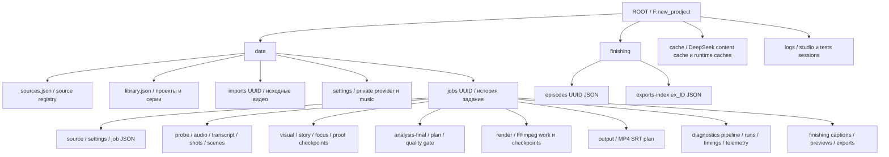

# КАДР: хранение данных и карта собственных модулей

Обновлено: 13 октября 2026 года. Общая схема и подробный порядок работы — в [architecture.md](architecture.md). Пути ниже относительно корня проекта. Это инвентаризация собственного кода; tools, node_modules, model weights, wheel caches и сторонние библиотеки не считаются собственными модулями. Частные значения настроек не читались. Наличие теста в таблице не означает, что он запускался или подтверждает качество реального видео.

## 1. Верхний уровень

| Папка/файл | Назначение и владелец | Удалять при обычной уборке? |
|---|---|---|
| `app/` | Python приложение и runtime pipeline | Нет; только после проверки imports/callers/контрактов |
| `devtools/` | Отдельно подключаемые разработческие MCP readers/проверки | Не входит в продуктовый запуск |
| `frontend/public/` | Единственные Studio Edition assets | Нет |
| `frontend/dist/` | Статика единственной Studio, которую отдаёт studio_routes | Восстановима build, но удаление немедленно ломает UI до пересборки |
| `scripts/`, `tests/` | Собственные диагностика, установка, проверки | По доказанному usage и документированным workflows |
| `data/` | Каталог, импорты, задания, настройки | Нет, это состояние пользователя |
| `finishing/` | Общие профили серии и export index; создаётся по запросу | Нет, часть состояния находится вне data |
| `models/` | Whisper и два Qwen+projector | Восстановимы explicit setup, но дороги по размеру/загрузке |
| `tools/` | Portable Python/FFmpeg/llama/CUDA и зависимости | Нет при обычной уборке |
| `music/` | Пользовательская музыка и локальный config | Нет |
| `cache/` | Wheels/runtime caches и подписанный DeepSeek response cache | Выборочно; paid responses и lineage сохранять |
| `logs/` | Operational logs, latest pointer, startup log | По retention после сохранения доказательств ошибки/прогона |
| `temp/`, `scratch/`, `ТЕСТЫ/` | Временные/экспериментальные/отчётные материалы | Только по проверке назначения, незавершённых задач и пользовательских результатов |
| `.agent/`, `.agents/`, `docs/` | Планы, agent workflows, архитектура/решения/аудиты | Нет |
| `.git/`, `.github/` | История и CI workflows | Нет |
| `1_Запустить_Кадр.bat`, `start.bat` | Пользовательский запуск и его служебный start.bat | Нет |
| `остановить_Кадр.bat`, `открыть_логи.bat`, `setup.bat` | Idle stop, открытие журналов и explicit setup | Нет |
| MP4/MKV в корне | Оригиналы источников, видимые registry | Нет |

`config.setup_environment` направляет рабочие TEMP/TMP/TMPDIR, Hugging Face, pip, CUDA, Torch, Python bytecode внутрь проекта. Реальные пути — [config.py](../../app/config.py); portable interpreter — `tools/python/python.exe`. Установки/скачивание выполняются только явными setup workflows.

MCP: [mcp_server](../../app/mcp_server.py) настраивает workspace environment и запускает продуктовый stdio; [mcp_runtime](../../app/mcp_runtime.py) владеет протоколом SDK; [mcp_contract](../../app/mcp_contract.py) — строгими схемами, ошибками, пагинацией, redaction и replay journal; [mcp_product](../../app/mcp_product.py) — loopback HTTP, identity и проверкой принадлежности целей. Отдельный [devtools/mcp_server](../../devtools/mcp_server.py) подключает [mcp_dev](../../devtools/mcp_dev.py), [mcp_readers](../../devtools/mcp_readers.py) и [mcp_tasks](../../devtools/mcp_tasks.py); [task_worker](../../devtools/task_worker.py) ожидает назначение родительского Job Object и исполняет только фиксированный каталог проверок. `data/mcp/operations` хранит защищённые результаты продуктовых команд, `temp/mcp-operations`, `temp/mcp-tasks`, `temp/mcp-benchmarks` — разработческие операции/вывод. Чтение не создаёт этих папок. [test_mcp](../../tests/test_mcp.py) проверяет реальный stdio-контракт, targeting, replay, revisions и доступ к файлам. Полный контракт — [mcp.md](../mcp.md).

## 2. Что куда записывается

### 2.1. Глобальное состояние

| Путь | Содержание | Код |
|---|---|---|
| `data/sources.json` | source UUID → абсолютный путь и исходное имя | [jobs](../../app/jobs.py) |
| `data/library.json` | Проекты, серии, настройки, архивные flags, связи jobs | [library](../../app/library.py) |
| `data/.server.lock` | Блокировка экземпляра manager, не очередь заданий | [jobs.InstanceLock](../../app/jobs.py) |
| `data/imports/<UUID>/<name.mp4|mkv>` | Копия пользовательского импорта; временно `.upload` | [server.import_source](../../app/server.py) |
| `data/settings/` | Частная provider configuration, ключи; music preferences | [deepseek](../../app/deepseek.py), [music](../../app/music.py) |
| `music/config.json`, `data/settings/music.json` | Базовый config и сохранённые предпочтения | [music](../../app/music.py) |
| `finishing/episodes/<episode>.json` | Разделяемый профиль оформления с revision | [finishing](../../app/finishing.py) |
| `finishing/exports-index/ex_<id>.json` | export UUID → source_job_id | [studio_render](../../app/studio_render.py) |
| `cache/deepseek/<prefix>/<digest>.json` | Подписанный успешный remote response; старый flat lookup совместим | [deepseek.target_cache_path / cache_file_path](../../app/deepseek.py) |
| `logs/LATEST.txt`, `logs/startup.log` | Последняя log session / старт батника | [run_logging](../../app/run_logging.py), [start.bat](../../start.bat) |

Исторические spending/ledger/balance файлы могут остаться на диске, но текущий DeepSeek adapter не использует их для денежных решений. Текущая статистика token usage не является стоимостью аккаунта. Каталог projects/episodes и физическое удаление jobs имеют разные semantics.

### 2.2. Содержимое `data/jobs/<job_id>/`

| Артефакт | Для чего | Сохранять для resume/проверки |
|---|---|---|
| `job.json`, `source.json` | Статус и registered original; основа job catalog | Обязательно |
| `analysis-settings.json`, `render-settings.json`, `editorial-settings.json`, optional `planning-preferences.json` | Снимки provider, layout/captions, editorial policy и preferred_part_count | Обязательно |
| `.start`, `.cancel`, `worker.log` | Process ownership gate, cancel marker, stdout/stderr | Не вручную менять в живом задании |
| `analysis.meta.json` | Source SHA + analysis version | Обязательно для контроля соответствия |
| `probe.json`, `audio.wav`, `audio.log` | Source technical metadata и mono ASR audio | Audio дорог повторно; probe восстановим |
| `transcript.json`, `asr.log`, `asr-repair.log` | words/segments и ASR repair provenance | Обязательно для воспроизводимого анализа |
| `shots.json`, соседние shot metadata/evidence | Accepted cuts и raw/suppressed candidates | Да |
| `media-evidence.json`, `.meta.json`, `media-evidence/` | Визуальные/звуковые measured features, frames, PCM | Да; cache проверяет содержимое source frames |
| `scenes.json`, `scenes.meta.json`, `scene-features.json`, `scene-features.meta.json` | Группировка и свойства исходных scene intervals | Да |
| `boundary-frames/`, `boundary-verification/` | Current-source boundary картинки и проверенные ответы | Да |
| `visual/event_*.json`, `*_chunk_*.checkpoint.json`, images/storyboard JSON | Completed scene/chunk understanding | Да; изображения входят в validation |
| `story_refinement/`, `credit_edges/`, production/title/source-role и другие signed proof каталоги | Детальные решения selection/credit/novelty и original evidence | Да; не отдельные «старые версии кода» |
| `title_units/`, `closing_novelty/`, `global_verification/`, `selection-adjudication/`, `pacing/`, `pacing_sequences/`, `endings/` | Signed decisions конкретных проверок и картинки доказательств | Да |
| `story-structure/`, `dialogue-relations/`, `continuity-verification/` | Source-unit relations, dialogue и targeted omitted-footage caches | Да |
| `story-events.json`, `story.json` | Derived story checkpoint и глобальная сводка | Да |
| `events.json`, `events.meta.json`, `focus/` | Финальные events и layout/provider signature, focus samples | Да |
| `episode_profile.json`, `story_structure-result.json`, `dialogue_relations-result.json` | Фактический профиль и принятое отношение source units | Да |
| `analysis-final.json`, `plan.json`, `final_quality_gate.json` | Проверенный final analysis, монтаж и quality history | Обязательно |
| `part-context/part_NNN.json`, картинки | Optional title/synopsis/image prompt cache | Да для reuse; не готовая графическая обложка |
| `render/part_NNN/` | filter script, ASS, partial MP4, render-info, process logs | Checkpoint и metadata сохранять; partial только после остановки |
| `render/part_NNN.json` | Fingerprint, size/mtime, SRT hash, encoder/run_id | Обязательно для безопасного cached export |
| `output/part_NNN.mp4`, `.srt`, внутренний `.ass`, `plan.json` | Готовые файлы и финальные music metadata; публичный file API регистрирует только MP4/SRT | Обязательно |
| `previous_exports/<UUID>/` | Архив obsolete checkpoint-verified parts после успешной замены | По retention, не до подтверждения нового результата |
| `runs/<UUID>.json`, `timings.json` | Попытки, source/code/settings provenance, timings | Обязательно для сравнения прогона |
| `model-performance.jsonl`, `token-usage.jsonl` | Local VLM timing/request и фактические usage | Да |
| `diagnostics/pipeline/` | Timeline, decisions, selection snapshots, summary/warnings | Да; подробные данные частные |
| `diagnostics/analysis-v.../` | Архив несовместимых derived checkpoints при старой analysis version | Не считать мусором без проверки lineage |
| `finishing/captions_NNN.json` | Пользовательские subtitle overrides с revision | Обязательно |
| `finishing/previews/pv_<id>/`, `finishing/exports/ex_<id>/` | Isolated status/output/work, render-error.log | Готовые пользовательские exports сохранять |

Названия отдельных proof каталогов определены внутри stage modules и могут меняться по версии; исходные JSON/stage signature надо читать до prune. Нет правила «всё кроме output — мусор»: эти файлы предотвращают повторный многочасовой/платный анализ.

### 2.3. Подписи и границы reuse

1. `analysis.meta`: полный SHA-256 исходного файла + analysis version. Изменение source блокирует старое задание, а не silently reuse. Разрешённый upgrade старой версии архивирует derived artifacts и оставляет factual audio/ASR/shots.
2. Scene/perception signatures: original source identity, duration, shots/transcript, detector/profile settings, измеренные картинки и версия. Raw feature caches не должны принимать пользовательские semantic answers как источник истины.
3. Scene/chunk checkpoints: source/settings semantic identity, CURRENT units, соседний контекст, provider/model и SHA картинок. Ранняя visual signature может остаться прежней после story-only edits, но текущий scene semantic identity и image hashes всё равно проверяются.
4. `derived_story_identity`: analysis key, semantic component hashes, stage versions, provider, editorial profile, image-page capability и production policies. `story-events.json` degraded state не принимается как complete cache hit.
5. `events.meta`: derived key + pacing/endings/recovery versions + layout + pacing provider. Layout не заставляет повторять дорогой story selection, но меняет focus/final events.
6. Plan fingerprint: финальный analysis, исходный path/size/mtime, semantic components, planner/renderer versions, editing/editorial/music identities и font/subtitle style.
7. Cached MP4: общий fingerprint + проверенные size/mtime + SRT SHA + FFprobe export validation. Старый encoder provenance без сведения не придумывается.
8. Part context: отдельная signature по source/cuts/text/provider/models. Эти metadata не меняют MP4 fingerprint.
9. Remote responses: request content/schema/image hashes/model identity определяют digest; cache hit не вызывает новый paid request. [deepseek](../../app/deepseek.py) проверяет JSON/schema и successful cache; migration/prune — отдельный [CLI](../../scripts/prune_cache.py).

Source hash — доказательство байтового совпадения файла; file size/mtime — более дешёвая модельная/медийная stamp. Это разные гарантии. Нельзя переносить случайный events/plan JSON между разными sources только потому, что длительность одинаковая.

## 3. Карта всех модулей `app/`

| Модуль | Назначение / важная граница |
|---|---|
| [__init__](../../app/__init__.py) | Определение пакета локального condensation приложения |
| [config](../../app/config.py) | Project paths, offline environment и global readiness |
| [launcher](../../app/launcher.py) | Запуск/поиск правильного Studio экземпляра и открытие после готовности |
| [studio_identity](../../app/studio_identity.py) | Backend/UI fingerprints для handshake |
| [server](../../app/server.py) | FastAPI, source import, library/job/music/provider API, range files; Studio routing делегирован studio_routes |
| [jobs](../../app/jobs.py) | Source/job JSON, locks, один worker, cancel/retry, cleanup/prune |
| [library](../../app/library.py) | Project/episode ownership, сохранённые настройки и tombstones |
| [worker](../../app/worker.py) | Один pipeline job в child, status/progress/error publication |
| [pipeline](../../app/pipeline.py) | Run manifests, analysis→plan→quality→context→render, ordered checkpoints |
| [json_store](../../app/json_store.py) | Единственная атомарная запись JSON, чтение и явные контракты encodings |
| [source_ranges](../../app/source_ranges.py) | Общая математика исходных диапазонов: merge/intersection/ordered subtraction |
| [http_media](../../app/http_media.py) | HTTP byte-range выдача уже разрешённого пути без композиции server |
| [analysis_provider](../../app/analysis_provider.py) | Сохранённые настройки провайдера, identity, routing и обязательные model files |
| [antigravity_exchange](../../app/antigravity_exchange.py) | Ручной transport пакетов, строгий импорт JSON, ожидание результата и provider banks |
| [analysis](../../app/analysis.py) | Последовательный stage orchestration и derived cache identities; reexports нижних utilities |
| [media_probe](../../app/media_probe.py) | FFprobe, subprocess runner, raw/accepted shots, analysis windows, transcript normalization |
| [inference](../../app/inference.py) | Isolated Whisper ASR и bounded VAD repair |
| [provided_asr](../../app/provided_asr.py) | Source-bound supplied transcript validation без фиктивной ASR provenance |
| [vision](../../app/vision.py) | Local llama-server/session/provider routing, запросы JSON, storyboard extraction |
| [bounded_storyboard](../../app/bounded_storyboard.py) | Проверенные video PTS и small source-only collages |
| [media_evidence](../../app/media_evidence.py) | Measured embeddings/flow/audio/fades, без внешних semantic labels |
| [scene_detection](../../app/scene_detection.py) | Semantic grouping, features, independent boundary proposals, chunks |
| [semantic_boundary](../../app/semantic_boundary.py) | Cheap triage и VLM проверка CURRENT transitions |
| [scene_analysis](../../app/scene_analysis.py) | Frame-backed scenes, bounded chunk understanding и scene-owned checkpoints |
| [scene_understanding](../../app/scene_understanding.py) | Confidence/ownership validation, плотное uncertainty recovery |
| [scene_refinement](../../app/scene_refinement.py) | Story refinement технических детей и merge proof в parent scene |
| [story_review](../../app/story_review.py) | Source units, event/global omission validation, global story query |
| [story](../../app/story.py) | Keep/drop source-unit condensation, omission proofs и speech/credits guards |
| [production](../../app/production.py) | Original credit context, contact sheets, единичная sequence membership |
| [production_sequence](../../app/production_sequence.py) | Whole OP/ED cluster authority, anchors/boundaries/exceptions |
| [eyecatch](../../app/eyecatch.py) | Эвристика TV mid-episode bumper и очистка selection |
| [titles](../../app/titles.py) | Independent visible production-title classifiers |
| [closing](../../app/closing.py) | Closing novelty относительно ранее retained facts |
| [source_roles](../../app/source_roles.py) | Skeptical nonstory classification, confirmed exclusions, verified story ownership |
| [global_verification](../../app/global_verification.py) | Независимая визуальная глобальная проверка по оригинальным units |
| [selection_adjudication](../../app/selection_adjudication.py) | Targeted current-unit evidence для спорного отбора |
| [selection_gate](../../app/selection_gate.py) | Source/final selection readiness; unresolved блокирует planning |
| [speech_context](../../app/speech_context.py) | Source ASR prefixes и question/answer protections |
| [pacing](../../app/pacing.py) | Silent margins/sequences/repetition с before/current/after evidence |
| [endings](../../app/endings.py) | Source-bounded концовки parts и восстановление fallback границ |
| [story_structure_pass](../../app/story_structure_pass.py) | Inference канонических facts/relations/arcs по принятому source evidence |
| [dialogue_relations](../../app/dialogue_relations.py) | Source-unit отношения диалога, pure candidate pass + provider pass |
| [story_structure](../../app/story_structure.py) | Pure story arcs/continuity, без model/media I/O |
| [source_continuity](../../app/source_continuity.py) | Pure state paths между CURRENT units, unresolved gaps |
| [continuity_verification](../../app/continuity_verification.py) | Проверка omitted original units, включая omitted внутри retained parent |
| [episode_profile](../../app/episode_profile.py) | Factual pace metrics, adaptive grouping/retention budget |
| [retention_allocation](../../app/retention_allocation.py) | Mandatory ranges и ranked optional ranges с ценой context |
| [planner](../../app/planner.py) | Deterministic timeline, validation, protected boundaries, cuts/subtitles |
| [dramatic_planner](../../app/dramatic_planner.py) | Dramatic score/hook/part objectives поверх source contract |
| [planner_audit](../../app/planner_audit.py) | Объяснение сохранённых/удалённых интервалов, alternatives |
| [final_quality](../../app/final_quality.py) | Доказательная pre-render проверка; без запуска recovery |
| [framing](../../app/framing.py) | Shot/reply temporal portrait focus и координатные checkpoints |
| [part_context](../../app/part_context.py) | Optional title/synopsis/image prompt из финальных cuts; extractive fallback |
| [media](../../app/media.py) | FFmpeg export, smooth crop, format validation и atomic publication |
| [subtitles](../../app/subtitles.py) | Word clocks, font width wrapping, classic/accent ASS/SRT |
| [audio_analysis](../../app/audio_analysis.py) | Transcript-based music intervals и background ducking expressions |
| [music](../../app/music.py) | Track listing/config/preferences/selection и library identity |
| [editing](../../app/editing.py) | Named layout/caption presets и compatibility defaults |
| [editorial](../../app/editorial.py) | Job editorial intent и validated policy отдельно от render/provider |
| [quality](../../app/quality.py) | Плановые quality_summary/debug_timeline для реально retained footage |
| [finishing](../../app/finishing.py) | Versioned editor state/caption overrides, preview/export/music routes |
| [studio_render](../../app/studio_render.py) | Isolated finishing threads/queue/semaphore/status и reuse base plan без ИИ |
| [deepseek](../../app/deepseek.py) | Remote JSON/image adapter, successful content cache, до 2 retries, disabled monetary compatibility |
| [hybrid](../../app/hybrid.py) | Local-first remote uncertainty review и job journal/fallback |
| [flash_story_trial](../../app/flash_story_trial.py) | Opt-in local early vision + remote story trial routing; название не означает offline |
| [semantic_identity](../../app/semantic_identity.py) | Import-free hashes code/prompts/constants/policy для semantic cache |
| [pipeline_diagnostics](../../app/pipeline_diagnostics.py) | Source decision timeline и per-stage snapshots |
| [model_perf](../../app/model_perf.py) | Append-only startup/request wall time, token/performance fields без prompts |
| [token_usage](../../app/token_usage.py) | Реальный provider usage; unknown usage не оценивается автоматически |
| [job_progress](../../app/job_progress.py) | Bounded read-only artifact counters и cached чтение |
| [run_logging](../../app/run_logging.py) | Project-local session logs для server/worker/tests и scrubbing |

Compatibility reexports `analysis` и `planner` не следует удалять без проверки reverse imports/tests: некоторые callers намеренно подменяют boundary factories через эти фасады.

### Явные владельцы, выделенные при очистке

| Модуль | Ответственность |
|---|---|
| [studio_routes](../../app/studio_routes.py) | Разрешённые Studio assets и ссылки экранов |
| [analysis_result](../../app/analysis_result.py) | Сборка сохранённого результата и diagnostics |
| [editorial_pipeline](../../app/editorial_pipeline.py) | Отбор, финал, сюжет и связи реплик |
| [quality_recovery](../../app/quality_recovery.py) | Адресное восстановление анализа по проблемам quality gate |
| [source_text](../../app/source_text.py) | Текст в исходных временных границах и доказательные цитаты |
| [cancellation](../../app/cancellation.py) | Кооперативная проверка отмены |
| [content_identity](../../app/content_identity.py) | Строгие JSON hashes с сохранением existing encoding |
| [antigravity_batch](../../app/antigravity_batch.py) | Пакетный адаптер независимых запросов с сохранением исходного контекста и проверки ответов |
| [speech_handles](../../app/speech_handles.py) | Исходные границы речи и минимальные поля для целых слов |

## 4. Собственные `scripts/`

| Скрипт | Назначение |
|---|---|
| [setup.py](../../scripts/setup.py), [setup.ps1](../../scripts/setup.ps1) | Явная portable установка/загрузка; единственная разрешённая штатная bootstrap сеть |
| [npm.cmd](../../scripts/npm.cmd) | Wrapper переносимого Node/npm: project temp/cache и запуск npm-cli.js без глобальной установки |
| [download_ranged.py](../../scripts/download_ranged.py) | Resumable workspace downloads с hashes/lock |
| [verify_project.ps1](../../scripts/verify_project.ps1) | Полный набор предусмотренных репозиторием checks |
| [test_full_pipeline_3min.ps1](../../scripts/test_full_pipeline_3min.ps1) | PowerShell harness 180-секундного pipeline |
| [benchmark_local_pipeline.py](../../scripts/benchmark_local_pipeline.py) | Добавлен в ходе аудита: изолированные real local excerpts, monotonic stage timing и CPU/RAM/GPU resources без remote provider |
| [full_pipeline_3min.py](../../scripts/full_pipeline_3min.py) | Offline fixture/export checks или real analysis, отдельные режимы |
| [prepare_real_test_video.py](../../scripts/prepare_real_test_video.py) | Read-only оригинал → isolated реальный story excerpt |
| [observe_job.py](../../scripts/observe_job.py) | Запись фактических смен стадии своего задания |
| [publish_job_progress.py](../../scripts/publish_job_progress.py) | Read-only progress counters через локальную static directory |
| [export_local_audit_report.py](../../scripts/export_local_audit_report.py) | Добавлен в ходе аудита: standalone CSV/JSON/Markdown и SVG графики local benchmark, monotonic wall-time/resource/model показатели |
| [export_stage_timings.py](../../scripts/export_stage_timings.py) | Allowlisted stage/model reports, wall-time attribution |
| [export_safe_ai_diagnostics.py](../../scripts/export_safe_ai_diagnostics.py) | Allowlisted безопасная telemetry без media/ASR/prompts |
| [publish_latest_ai_diagnostics.ps1](../../scripts/publish_latest_ai_diagnostics.ps1) | Публикация уже подготовленной безопасной диагностики; не вызывать при только local audit |
| [offline_verify.py](../../scripts/offline_verify.py) | Повтор completed job с запретом внешних Python соединений |
| [smoke.py](../../scripts/smoke.py) | Короткий настоящий ASR/VLM/render на первом source |
| [visioncheck.py](../../scripts/visioncheck.py) | Installed model diagnostic для одного local image |
| [deepseek_smoke.py](../../scripts/deepseek_smoke.py) | До 3 framing samples через remote/cache-only; не fully local |
| [prune_cache.py](../../scripts/prune_cache.py) | DeepSeek cache stats/shard migration/retention |
| [shot_diagnostic.py](../../scripts/shot_diagnostic.py) | CPU shot threshold calibration на заданных source windows |
| [framingdiagnostic.py](../../scripts/framingdiagnostic.py) | Изолированное local focus prompt comparison |
| [check_title_units.py](../../scripts/check_title_units.py) | Title classifier diagnostics на baseline source events |
| [calibrate_episode_profile.py](../../scripts/calibrate_episode_profile.py) | Offline калибровка cached measured profile, без model calls |
| [audit_montage.py](../../scripts/audit_montage.py) | Generic source/output measurements и visual evidence |
| [evaluate_montage_quality_points.py](../../scripts/evaluate_montage_quality_points.py) | Sparse reviewed source points → план; не непрерывное доказательство границ |
| [review_comparison.py](../../scripts/review_comparison.py) | Source/old/new pixels, crop/caption и метрики |
| [review_framing.py](../../scripts/review_framing.py) | Timestamp-matched source/rendered frames |
| [review_outputs.py](../../scripts/review_outputs.py) | Chronological contact sheets и correlation original/output audio |
| [review_scene_endings.py](../../scripts/review_scene_endings.py) | Отдельная development preview сохранённых source facts |
| [run_regression_source.py](../../scripts/run_regression_source.py) | Обычный API job с reuse подтверждённых identical checkpoints |
| [run_raw_video_quality.py](../../scripts/run_raw_video_quality.py) | Actual local vision quality run без supplied semantic answers |
| [run_production_raw_quality.py](../../scripts/run_production_raw_quality.py) | Genuine production video+ASR observer, real analysis/export режимы |
| [verify_production_raw_exports.py](../../scripts/verify_production_raw_exports.py) | Read-only audit completed actual raw-video exports/SRT |

Diagnostics не равно безопасные unit tests: smoke/vision/title/framing/real-run могут загрузить GPU и делать inference, DeepSeek wrappers могут обращаться к remote. Offline full-pipeline fixture checks подтверждают FFmpeg/планирование/доставку, но не работу ASR/VLM над реальным source.

## 5. Собственный frontend

| Код | Назначение |
|---|---|
| [public/studio-edition.html](../../frontend/public/studio-edition.html) | Активная структура DOM и asset entry |
| [public/studio-edition.css](../../frontend/public/studio-edition.css) | Активные Studio layout/styles |
| [public/studio-edition-app.js](../../frontend/public/studio-edition-app.js) | Screen rendering, interaction, polling, finishing editor |
| [public/studio-live-bridge.js](../../frontend/public/studio-live-bridge.js) | Реальный API adapter/state, lazy plan/caption loading, diagnostics |
| [public/favicon.svg](../../frontend/public/favicon.svg) | Иконка UI |
| [scripts/smoke-studio-exact.mjs](../../frontend/scripts/smoke-studio-exact.mjs) | Browser проверка точного Studio дизайна/потоков |
| [scripts/smoke-studio-bridge.mjs](../../frontend/scripts/smoke-studio-bridge.mjs) | Browser проверка реального backend bridge |
| [scripts/build-studio.mjs](../../frontend/scripts/build-studio.mjs), [check-studio.mjs](../../frontend/scripts/check-studio.mjs) | Native Node build/watch и Studio проверки |
| [package.json](../../frontend/package.json), [package-lock.json](../../frontend/package-lock.json) | Реальные frontend commands/dependency pins |
| [README.md](../../frontend/README.md) | Frontend setup/документация |

React/legacy/reference удалены вместе с их отдельными проверками. Активную Studio проверяют два Node/jsdom integration scripts и Python entrypoint/route tests.

## 6. Карта проверок

Реальные команды объявлены в [pytest.ini](../../pytest.ini), [frontend/package.json](../../frontend/package.json), [scripts/verify_project.ps1](../../scripts/verify_project.ps1): portable Python `-m pytest`, frontend `npm run test`, `npm run build`, `npm run lint`. UI browser smoke и реальные model прогонки отдельны. Тест, который подставляет готовые events или semantic labels, проверяет алгоритм/контракт, но не способность модели правильно понять новый видеофайл.

Следующий реестр перечисляет каждый собственный test/fixture файл и его проверяемую область. Инвентарь снят с файлов; не vendor coverage report.

### 6.1. Python tests и browser fixtures

| Файл | Область и точка входа проверки |
|---|---|
| [browser_studio_smoke.py](../../tests/browser_studio_smoke.py) | Browser Studio smoke: навигация, start/stop/status и backend interaction |
| [library_contract_fixture.py](../../tests/library_contract_fixture.py) | Генератор real backend library fixture |
| [montage_fixtures.py](../../tests/montage_fixtures.py) | Изолированные supplied-state fixtures монтажа; не model E2E |
| [raw_video_fixtures.py](../../tests/raw_video_fixtures.py) | Сырые media/ASR fixtures и отдельные evaluator contracts |
| [test_adaptive_montage.py](../../tests/test_adaptive_montage.py) | Адаптивное подавление cuts и montage budgets; например `test_analysis_result_persists_initial_and_refined_profile_with_raw_evidence` |
| [test_adaptive_shots.py](../../tests/test_adaptive_shots.py) | Принятие/подавление shot candidates; например `test_parse_shot_candidates_extracts_pts_and_scores` |
| [test_analysis.py](../../tests/test_analysis.py) | Контракты/регрессии [analysis](../../app/analysis.py); например `test_global_omission_is_honored_but_dependency_can_restore_it` |
| [test_analysis_provider.py](../../tests/test_analysis_provider.py) | Выбор provider и маршрутизация модели; например `test_deepseek_story_needs_local_visual_4b_but_not_story_9b` |
| [test_api.py](../../tests/test_api.py) | FastAPI source/job/export API; например `test_folder_picker_does_not_silently_select_downloads_when_dialogs_fail` |
| [test_asr_repair.py](../../tests/test_asr_repair.py) | Подозрительные VAD gaps и bounded re-recognition; например `test_wrong_negation_timestamp_repaired_and_missing_client_restored` |
| [test_audio_analysis.py](../../tests/test_audio_analysis.py) | Контракты/регрессии [audio_analysis](../../app/audio_analysis.py); например `test_detect_transcript_music_intervals_finds_songs` |
| [test_benchmark_local_pipeline.py](../../tests/test_benchmark_local_pipeline.py) | Изолированный local benchmark: stage measurements и cooperative cancellation; например `test_instrumentation_preserves_progress_and_adds_cooperative_cancellation` |
| [test_boundary_triage_performance.py](../../tests/test_boundary_triage_performance.py) | Ограничение количества visual boundary requests; например `test_selects_high_priority_physical_transition_without_inventing_scene` |
| [test_bounded_frame_contract.py](../../tests/test_bounded_frame_contract.py) | Bounded source-frame PTS contract; например `test_chunk_planner_and_actual_frame_renderer_have_same_default_limit` |
| [test_bounded_storyboard.py](../../tests/test_bounded_storyboard.py) | Контракты/регрессии [bounded_storyboard](../../app/bounded_storyboard.py); например `test_two_second_context_is_two_original_frames_on_one_small_page` |
| [test_closing.py](../../tests/test_closing.py) | Контракты/регрессии [closing](../../app/closing.py); например `test_recaps_removed_only_after_ending_anchor_and_office_unchanged` |
| [test_cloud_story_full_e2e.py](../../tests/test_cloud_story_full_e2e.py) | Cloud story E2E harness; требует явного opt-in к remote; например `test_paid_story_launcher_requires_explicit_confirmation_and_real_production` |
| [test_continuity_verification.py](../../tests/test_continuity_verification.py) | Оригинальные omitted source units и continuity evidence; например `test_exact_scoped_refs_accept_and_output_does_not_alias_input` |
| [test_credit_fast_path.py](../../tests/test_credit_fast_path.py) | Быстрый маршрут доказанных credit sequences; например `test_credit_classifier_disables_reasoning_only_for_that_request` |
| [test_deepseek.py](../../tests/test_deepseek.py) | Контракты/регрессии [deepseek](../../app/deepseek.py); например `test_canonical_identifier_pattern_rejects_mention_paths` |
| [test_dialogue_relations.py](../../tests/test_dialogue_relations.py) | Контракты/регрессии [dialogue_relations](../../app/dialogue_relations.py); например `test_unpunctuated_question_and_concrete_location_answer` |
| [test_dramatic_planner.py](../../tests/test_dramatic_planner.py) | Контракты/регрессии [dramatic_planner](../../app/dramatic_planner.py); например `test_hook_trimming_eliminates_initial_dead_air` |
| [test_endings.py](../../tests/test_endings.py) | Контракты/регрессии [endings](../../app/endings.py); например `test_completed_beat_farther_from_target_is_reviewed_in_bounded_pages` |
| [test_episode_profile.py](../../tests/test_episode_profile.py) | Контракты/регрессии [episode_profile](../../app/episode_profile.py); например `test_four_profiles_use_measured_movement_and_actual_asr_occupancy` |
| [test_eyecatch.py](../../tests/test_eyecatch.py) | Контракты/регрессии [eyecatch](../../app/eyecatch.py); например `test_detect_eyecatches_finds_mid_episode_bumper` |
| [test_fast_local_story.py](../../tests/test_fast_local_story.py) | Экспериментальная local 4B story routing; например `test_fast_story_routes_only_story_to_local_4b_no_network` |
| [test_final_quality.py](../../tests/test_final_quality.py) | Контракты/регрессии [final_quality](../../app/final_quality.py); например `test_complete_production_proof_chain_before_render` |
| [test_finishing.py](../../tests/test_finishing.py) | Контракты/регрессии [finishing](../../app/finishing.py); например `test_finishing_profile_persists_and_validates_without_touching_analysis` |
| [test_flash_story_budgeted.py](../../tests/test_flash_story_budgeted.py) | Trial Flash budgeted compatibility и fallback; например `test_legacy_profile_is_opt_in_but_unrestricted` |
| [test_flash_story_trial.py](../../tests/test_flash_story_trial.py) | Trial remote story routing; например `test_no_artificial_http_call_cap_for_remote_story` |
| [test_framing.py](../../tests/test_framing.py) | Контракты/регрессии [framing](../../app/framing.py); например `test_reply_uses_word_midpoint_but_boundary_time_and_deduplicates_shot` |
| [test_full_pipeline_harness.py](../../tests/test_full_pipeline_harness.py) | Offline/real harness разделение и артефакты; например `test_synthetic_fixture_always_has_six_bounded_intervals_in_real_180s_clock` |
| [test_global_verification.py](../../tests/test_global_verification.py) | Контракты/регрессии [global_verification](../../app/global_verification.py); например `test_wrong_conversation_hypothesis_is_corrected_from_actual_images_and_units` |
| [test_hybrid.py](../../tests/test_hybrid.py) | Local-first remote review и fallback; например `test_confident_schema_valid_but_semantically_invalid_local_routes_remote` |
| [test_inference.py](../../tests/test_inference.py) | Контракты/регрессии [inference](../../app/inference.py); например `test_cuda_iteration_oom_retries_complete_cpu_transcript_with_same_local_model` |
| [test_job_progress.py](../../tests/test_job_progress.py) | Bounded read-only stage counters; например `test_current_run_unique_boundary_decisions_not_model_acceptance` |
| [test_jobs.py](../../tests/test_jobs.py) | Контракты/регрессии [jobs](../../app/jobs.py); например `test_default_analysis_remains_local_without_reading_deepseek_settings` |
| [test_launcher.py](../../tests/test_launcher.py) | Launcher readiness, identity и существующий server; например `test_missing_server_starts_server_and_schedules_browser_after_readiness` |
| [test_media.py](../../tests/test_media.py) | Контракты/регрессии [media](../../app/media.py); например `test_shot_boundary_jumps_at_boundary_while_reply_focus_remains_smooth` |
| [test_media_evidence.py](../../tests/test_media_evidence.py) | Контракты/регрессии [media_evidence](../../app/media_evidence.py); например `test_normalized_embedding_tolerates_lighting_and_subtitle_strip` |
| [test_model_perf.py](../../tests/test_model_perf.py) | Startup/request telemetry и purpose attribution; например `test_query_latency_tokens_model_stage_and_startup_are_allowlisted` |
| [test_montage_regressions.py](../../tests/test_montage_regressions.py) | Сохранённые regression scenarios монтажа; например `test_01_conversation_binding_car_survive_as_bounded_causal_path` |
| [test_music.py](../../tests/test_music.py) | Контракты/регрессии [music](../../app/music.py); например `test_defaults_when_file_missing` |
| [test_narrative_bridge.py](../../tests/test_narrative_bridge.py) | Минимальные source context bridges; например `test_narrative_bridge_event_immune_to_global_omission` |
| [test_output_review.py](../../tests/test_output_review.py) | Реальное сопоставление source/output pixels/audio; например `test_audio_tail_does_not_request_a_nonexistent_video_frame` |
| [test_pacing.py](../../tests/test_pacing.py) | Контракты/регрессии [pacing](../../app/pacing.py); например `test_sequence_review_crosses_artificial_event_windows_and_keeps_actual_arrival` |
| [test_part_context.py](../../tests/test_part_context.py) | Metadata title/synopsis/image prompt и fallback; например `test_evidence_excludes_boundary_crossing_and_removed_scenes` |
| [test_planner.py](../../tests/test_planner.py) | Контракты/регрессии [planner](../../app/planner.py); например `test_confirmed_title_removal_survives_dialogue_restoration_and_padding` |
| [test_prepare_real_test_video.py](../../tests/test_prepare_real_test_video.py) | Bounded real-source excerpt preparation; например `test_real_180_second_in_project_keeps_original_unchanged` |
| [test_production.py](../../tests/test_production.py) | Контракты/регрессии [production](../../app/production.py); например `test_legacy_provider_dispatch_applies_confirmed_credit_unit_to_final_ranges` |
| [test_production_entrypoints.py](../../tests/test_production_entrypoints.py) | Маршруты production и запрет supplied evaluator answers; например `test_old_interface_shortcut_delegates_to_real_entrypoint` |
| [test_production_sequence.py](../../tests/test_production_sequence.py) | OP/ED whole-source authority и anchors; например `test_sequence_units_keep_reply_tail_before_actual_opening_shot` |
| [test_profile_planner_integration.py](../../tests/test_profile_planner_integration.py) | Фактический episode profile → planner budget; например `test_analysis_finalizes_measured_profile_and_planner_reuses_identical_snapshot` |
| [test_provided_asr.py](../../tests/test_provided_asr.py) | Контракты/регрессии [provided_asr](../../app/provided_asr.py); например `test_valid_source_bound_asr_has_truthful_provenance_without_fake_repair` |
| [test_quality.py](../../tests/test_quality.py) | Контракты/регрессии [quality](../../app/quality.py); например `test_stale_removed_event_warning_is_dropped_and_profile_note_is_separate` |
| [test_quality_pipeline.py](../../tests/test_quality_pipeline.py) | Обязательные quality gates в production; например `test_unresolved_source_stops_before_builder_and_render_after_three_recoveries` |
| [test_question_context.py](../../tests/test_question_context.py) | Вопрос/ответ и causal context; например `test_global_redundancy_cannot_leave_retained_answer_without_question` |
| [test_raw_export_quality.py](../../tests/test_raw_export_quality.py) | Technical/source contract настоящих exports; например `test_completed_artifact_mechanism_preserves_reaction_removes_neutral` |
| [test_raw_fixture_contract.py](../../tests/test_raw_fixture_contract.py) | Разделение сырых media fixtures и evaluator labels; например `test_all_seven_sources_are_actual_decodable_media_without_semantic_inputs` |
| [test_recovery_tokens.py](../../tests/test_recovery_tokens.py) | Token provenance при recovery; например `test_tokens_are_real_success_and_rejected_calls_and_survive_restart` |
| [test_retention_allocation.py](../../tests/test_retention_allocation.py) | Контракты/регрессии [retention_allocation](../../app/retention_allocation.py); например `test_optional_source_arc_defers_oversized_seed_when_another_complete_arc_fits` |
| [test_run_logging.py](../../tests/test_run_logging.py) | Session logs и scrub; например `test_credentials_are_redacted_even_in_freeform_error_and_stack` |
| [test_safe_ai_diagnostics.py](../../tests/test_safe_ai_diagnostics.py) | Allowlist отчёта без частных данных; например `test_failed_test_exports_diagnostics_but_never_dialogues_or_prompts` |
| [test_scene_detection.py](../../tests/test_scene_detection.py) | Контракты/регрессии [scene_detection](../../app/scene_detection.py); например `test_a_four_second_binding_between_conversation_and_car_is_preserved` |
| [test_scene_refinement.py](../../tests/test_scene_refinement.py) | Scene-owned technical refinement и source proof merge; например `test_child_collage_ids_and_single_parent_with_bounded_selections` |
| [test_scene_understanding.py](../../tests/test_scene_understanding.py) | CURRENT ownership/confidence и dense recovery; например `test_schema_requires_confidence_and_current_evidence_fields` |
| [test_selection_adjudication.py](../../tests/test_selection_adjudication.py) | Контракты/регрессии [selection_adjudication](../../app/selection_adjudication.py); например `test_silent_current_cannot_borrow_a_spoken_contribution_from_context` |
| [test_selection_gate.py](../../tests/test_selection_gate.py) | Контракты/регрессии [selection_gate](../../app/selection_gate.py); например `test_source_gate_preserves_downstream_failure_without_repeating_visual_inference` |
| [test_semantic_boundary.py](../../tests/test_semantic_boundary.py) | Контракты/регрессии [semantic_boundary](../../app/semantic_boundary.py); например `test_schema_requires_flags_and_concrete_evidence` |
| [test_semantic_identity.py](../../tests/test_semantic_identity.py) | Контракты/регрессии [semantic_identity](../../app/semantic_identity.py); например `test_identity_is_stable_json_and_covers_all_pipeline_components` |
| [test_semantic_pipeline.py](../../tests/test_semantic_pipeline.py) | Source-only semantic pipeline contracts; например `test_technical_chunks_remain_one_scene_event_and_reuse_cache` |
| [test_server_routing.py](../../tests/test_server_routing.py) | Единственная Studio, её assets/deep links; старые входы недоступны; например `test_studio_routes_serve_exact_ui_or_explicit_build_error` |
| [test_source_continuity.py](../../tests/test_source_continuity.py) | Контракты/регрессии [source_continuity](../../app/source_continuity.py); например `test_synonyms_with_same_canonical_ids_keep_state_without_redundant_restore` |
| [test_source_roles.py](../../tests/test_source_roles.py) | Source role exclusions и authority ownership; например `test_failed_role_review_retries_original_material_even_after_empty_selection` |
| [test_speech_context.py](../../tests/test_speech_context.py) | Контракты/регрессии [speech_context](../../app/speech_context.py); например `test_negation_is_restored_without_inventing_gap_speech` |
| [test_stage_timings.py](../../tests/test_stage_timings.py) | Wall-time report, nested/parallel stages и cache distinctions; например `test_complete_timing_safely_distinguishes_sequential_checks_and_nested_pipeline` |
| [test_story.py](../../tests/test_story.py) | Контракты/регрессии [story](../../app/story.py); например `test_frame_timestamp_rounded_to_chunk_end_retains_correct_source_owner` |
| [test_story_structure.py](../../tests/test_story_structure.py) | Контракты/регрессии [story_structure](../../app/story_structure.py); например `test_five_natural_arcs_preserve_supplied_roles_and_verified_complete_endings` |
| [test_story_structure_pass.py](../../tests/test_story_structure_pass.py) | Контракты/регрессии [story_structure_pass](../../app/story_structure_pass.py); например `test_genuine_provider_api_is_text_only_and_selection_unchanged` |
| [test_storyboard.py](../../tests/test_storyboard.py) | Временные метки и actual frame source storyboard; например `test_same_source_and_timestamps_reuse_extracted_frames` |
| [test_structure_planner_integration.py](../../tests/test_structure_planner_integration.py) | Source relations/arcs → planner; например `test_five_inferred_source_arcs_inside_one_scene_produce_five_parts` |
| [test_studio_identity.py](../../tests/test_studio_identity.py) | Контракты/регрессии [studio_identity](../../app/studio_identity.py); например `test_fingerprint_detects_worker_and_analysis_updates_and_new_modules` |
| [test_studio_shutdown.py](../../tests/test_studio_shutdown.py) | Identity-checked idle shutdown и запрет новых задач; например `test_idle_shutdown_sets_flag_but_preserves_lock_until_lifespan_exit` |
| [test_subtitles.py](../../tests/test_subtitles.py) | Контракты/регрессии [subtitles](../../app/subtitles.py); например `test_accent_captions_preserve_words_in_short_uppercase_blocks` |
| [test_titles.py](../../tests/test_titles.py) | Контракты/регрессии [titles](../../app/titles.py); например `test_only_current_confirmed_title_units_are_removed` |
| [test_token_performance_reports.py](../../tests/test_token_performance_reports.py) | Actual usage и local-model telemetry reports; например `test_model_averages_and_generation_throughput_weight_by_calls` |
| [test_verification_report_contract.py](../../tests/test_verification_report_contract.py) | Итоговый verification report schema; например `test_report_directory_created_before_checks_json_is_written` |

| [test_local_audit_report.py](../../tests/test_local_audit_report.py) | Границы local report: fresh/resume, незавершённые model requests, исключение частных данных и wall-time/resource attribution |

### 6.2. Studio проверки

| Файл | Ответственность |
|---|---|
| `frontend/scripts/smoke-studio-exact.mjs` | Экраны, finishing, captions, save через настоящий bridge с изолированным HTTP fixture |
| `frontend/scripts/smoke-studio-bridge.mjs` | API ошибки, lazy loading, retry и refresh |

## 7. Где менять нужное поведение

| Задача | Первый файл / важные соседи |
|---|---|
| Кнопка, экран, отображение active Studio | public/studio-edition-app.js и studio-live-bridge.js, затем server API |
| Источник не виден/не импортируется | jobs.list_sources/source, server.import_source, library ownership |
| Start/stop/retry зависает | launcher, jobs.WorkerProcess/JobManager, worker markers, run_logging |
| ASR медленный/неточная речь | inference + audio/probe; менять отдельно от story prompts |
| Слишком много/мало смысловых сцен | media_evidence, scene_detection, semantic_boundary, episode_profile |
| Потерян сюжет/реакция | story/scene_refinement, selection_adjudication, source_roles, final_quality; source proofs |
| Неверно вырезан OP/ED/title | production_sequence, production, titles, source_roles; eyecatch отдельно |
| Паузы длинные / слишком агрессивное сокращение | pacing + editorial profile + positive action evidence |
| Разрыв вопроса/ответа, состояния или действия | dialogue_relations, story_structure_pass, source_continuity, planner, continuity_verification |
| Лицо/действие за пределами portrait crop | framing, media.crop_expressions; cinema пропускает focus |
| Длительность/число частей | planner/dramatic_planner, retention_allocation, episode_profile; validate_plan |
| Субтитры, font, timings | subtitles и finishing caption overrides; original ASR отдельно |
| Размытие, zoom, музыка после монтажа | finishing, studio_render, media; новый ИИ-анализ не нужен |
| Slow local model request / GPU fallback | vision, model_perf, vision.log; затем settings конкретной стадии |
| Ошибка/повтор paid request | deepseek success cache и request schema; hybrid review journal при hybrid |
| Отчёт скорости/расхождение counters | pipeline timings, Diagnostics timeline, model_perf, job_progress |
| Cleanup/backup/resume | jobs prune/delete, config paths, весь data + finishing + signed response cache |

Рутинная уборка не является разрешением удалить original imports, пользовательские caption edits, completed exports или checkpoints незавершённого job. Перед переносом архитектурных границ следует использовать repository ExecPlan/ADR и сохранить возможность rollback.

## Дополнение: ручной Antigravity

Модуль `app/antigravity_exchange.py` принадлежит границе9B query: экспорт/строгий импорт, ожидание и банк контрольных точек. В задании добавляется `antigravity/packets/<hash>` (request/schema/prompt/pages/result/state/cli-attempts) и `antigravity/checkpoint-bank`. Это данные для продолжения; успешные ответы не являются мусором. `antigravity/automation.json` хранит настройку автоимпорта, `exchange.json` — текущий ожидаемый пакет, `runner.json` — состояние отдельного сценария; `runner.lock` исключает два сценария одновременно. Пользователь отдельно запускает `scripts/run_antigravity_packet.ps1` для одного пакета либо `scripts/run_antigravity_job.ps1` для последовательной обработки и автоимпорта. KADR не запускает CLI и не читает авторизацию. Инструкции, узкий CLI-профиль и проверенные результаты — в [руководстве](../antigravity-manual.md). Тесты границы: `tests/test_antigravity_exchange.py`.

Зоны ответственности и разрешённое направление зависимостей: [app/README](../../app/README.md). Альтернативный simulation planner удалён; диагностика использует рабочие planners и их существующие изолированные проверки.
